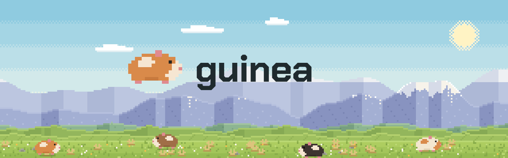

<div align="center">



*The application layer for Rust GUI.*

</div>

### Why

Rust has good toolkits and no application layer above them. The architecture is left to
you, so you borrow one from GC languages, and Rust's ownership fights it. What is left is
wiring - not the same in every toolkit, but no application past a demo escapes it:

- messages forwarded through layers to where they are handled;
- request ids, so a late answer does not overwrite a newer one;
- setup, teardown and refetching written by hand for every screen;
- one huge state everything reaches into, and no tests for it;
- handles threaded through constructors, and a `clone()` before every `move`;
- settings saved and synced by hand.

### What guinea is

MVI for a whole application:

- **Intent** - a page emits what the user asked for, and changes only its own view state;
- **Model** - a reducer, the one place a state changes, driven by an actor that decides;
- **View** - the page, written the way its toolkit works: WinUI, iced, egui, ratatui or Slint.

And the application is built out of pages. Everything lives in a scope - the
application's, a window's, a layout's, a page's - and goes with it: what a page set up
ends when the user leaves it, with nothing to tear down by hand. Nothing pushes you
towards global state: state lives with the screen that needs it, and is shared by
installing it higher up - in a layout, or in the application. A page reads what it
installed itself, what a layout above it exports, and what the application provides;
anything else is not in reach, and a test sets up exactly that and no more.
Settings go to [amethystate](https://github.com/guinea-rs/amethystate).

guinea takes its ideas from Kotlin, Swift, gpui and Next.js, and its shape from Rust's
ownership and types rather than from theirs.

> [!WARNING]
> **guinea is young, and its API still moves between minor versions.**
> WinUI is the backend a real application ([uniproc](https://github.com/uniproc-dev/uniproc)) runs on every day; the other four
> run the same example application and are tested, but nobody depends on them yet.

<!-- shown: counter -->
```rust
use guinea::prelude::*;
use guinea::winui::{Page, PageCx, Window, page, run};
use guinea::winui::reactor::{Button, StackPanel, TextBlock, View};

/// The state.
#[derive(Default, Clone, PartialEq, Debug)]
pub struct Count(pub u32);

/// How it changes.
#[reducer]
fn count(this: &mut Count, by: u32) {
    this.0 += by;
}

/// What the UI asks for.
pub struct Add(pub u32);

/// The domain: answers `Add`, and pushes the new state.
#[derive(Debug)]
pub struct Counting {
    push: Push<Count>,
}

actor! {
    Counting {
        handlers { Add }
    }
}

#[handler]
fn add(this: &mut Counting, Add(by): Add) {
    this.push.send(by);
}

// What the feature publishes to the pages that install it, or sit below.
feature! {
    pub Counter {
        exports { Count }
    }
}

#[installs]
fn counter(cx: &FeatureInitContext) -> anyhow::Result<Counter> {
    let (count, _) = cx.state::<Count>().driven_by(|push| Counting { push });
    Ok(Counter(count))
}

#[derive(Default)]
pub struct Home;

#[page]
impl Page for Home {
    fn install(ctx: &FeatureInitContext, _params: &()) -> anyhow::Result<Self> {
        ctx.install::<Counter>(&())?;
        Ok(Self::default())
    }

    fn view(&self, cx: &mut PageCx<'_, '_, Self>) -> View {
        let (count, dispatch) = cx.read::<Count>();

        StackPanel::new()
            .children((
                TextBlock::new().text(count.0.to_string()),
                Button::new()
                    .on_click(move || dispatch.emit(Add(1)))
                    .content(TextBlock::new().text("Add")),
            ))
            .into()
    }
}

fn main() -> anyhow::Result<()> {
    run(|_| Ok(Window::of::<Home>().title("Counter")))
}
```
<!-- /shown -->
