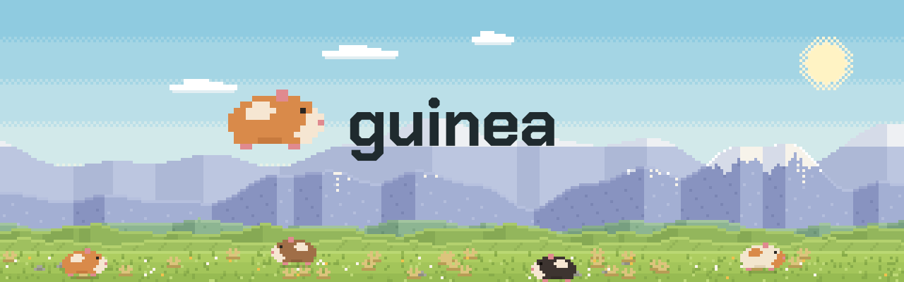
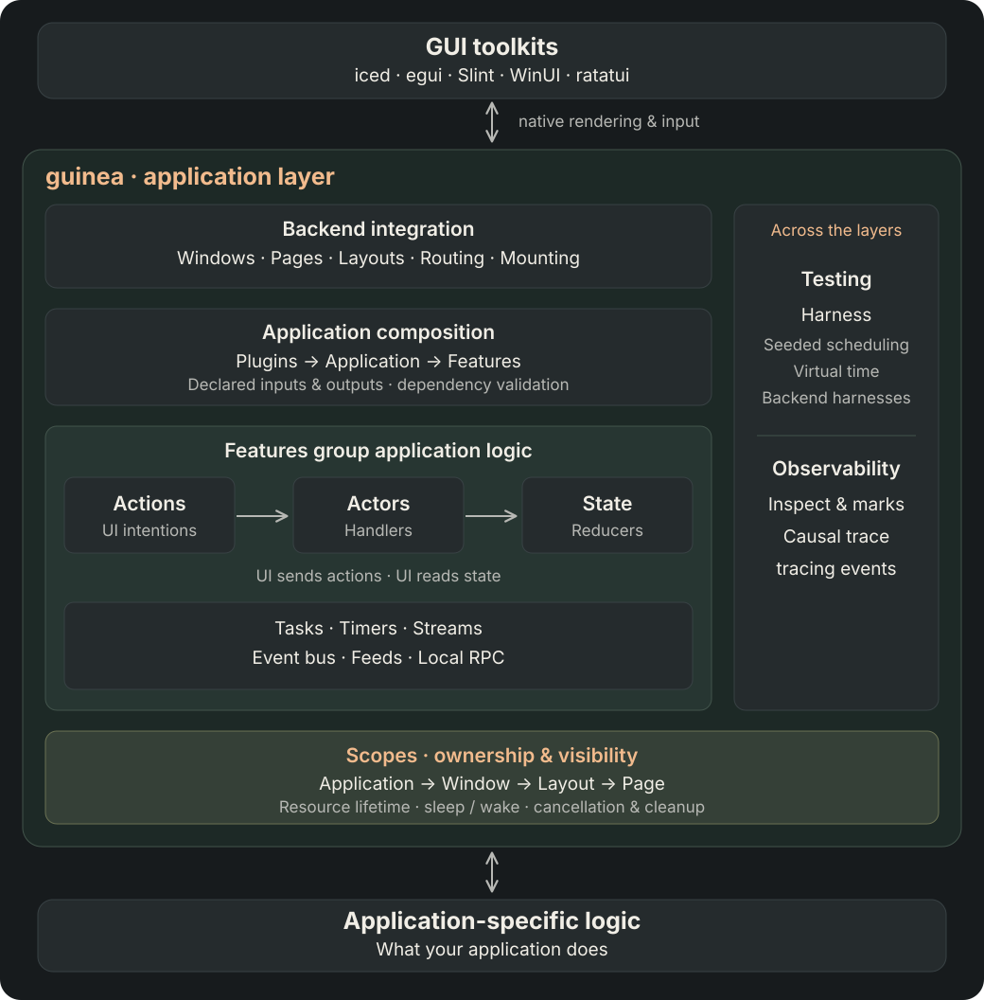

*The application layer for Rust GUI.*

[Read the book](https://guinea-rs.github.io/guinea/introduction/) ·
[Читать книгу на русском](https://guinea-rs.github.io/guinea/ru/introduction/)

[Todo application on five backends](https://github.com/guinea-rs/guinea/tree/master/examples)

### Why

Rust has good toolkits and no application layer above them: a toolkit draws the screen,
and how the application around it is built is left to each project. The answers differ,
but every application past a demo meets the same problems:

- messages forwarded through layers to where they are handled;
- request ids, so a late answer does not overwrite a newer one;
- setup, teardown and refetching written by hand for every screen;
- one huge state everything reaches into, and no tests for it;
- settings saved and synced by hand.

### What guinea is

guinea organizes application logic into **features**: state, actors, background
work and subscriptions that can be installed together. Features declare their
inputs and exports; guinea checks those declarations before installation.

Each feature belongs to a **scope** in the application, window, layout or page.
Install a feature on a page for local state, in a shared layout for several pages,
or at the application level for several windows. Removing a scope cancels its
registered tasks and releases its resources.

Pages send typed actions to actors, read state updated by reducers, and build UI
with their toolkit. Actors handle messages and coordinate work. The same
application logic can be exercised in a harness without opening a window.

### Architecture

Toolkits draw the interface; guinea connects it to scope-owned application logic.
Plugins and features declare what they need and provide. Scopes determine where
those values are visible and when their resources are released.

What an application needs besides its pages - a settings store, the window's geometry
remembered, localisation, a single instance, devtools - comes as
[plugins](https://github.com/guinea-rs/guinea-plugins).

guinea takes its ideas from Kotlin, Swift, gpui and Next.js. Its ownership is the one
Leptos and Dioxus arrived at - a tree of scopes owning `Copy` handles - put under
toolkits that do not have one.

### Observability with Perfetto

When a screen stalls, memory grows or state changes unexpectedly, guinea helps
you follow the work back to the action that started it.

- **Follow the chain.** See which action sent a message, which actor handled it,
  and what work and state updates followed, with links to available source locations.
- **Find expensive work.** Explore native CPU stacks alongside application events,
  with Guinea's causal context connecting sampled execution to the actions behind it.
- **Explain memory growth.** See which scopes and events allocate, how the Rust
  heap compares with process memory, and what remains allocated after a scope closes.
- **Understand state changes.** Optional reducer snapshots show what a message
  changed, with before/after values and a structural diff.

These views share one timeline in Perfetto, so you can investigate a slow action,
its allocations and its effect on state in the same recording. Save the session
to revisit it or share it with someone investigating the problem.

[Explore profiling with guinea-profile](tools/guinea-profile/README.md).

> [!WARNING]
> **guinea is young, and its API still moves between minor versions.**
> WinUI is the backend a real application ([uniproc](https://github.com/uniproc-dev/uniproc)) runs on every day; the other four
> run the same example application and are tested, but nobody depends on them yet.
