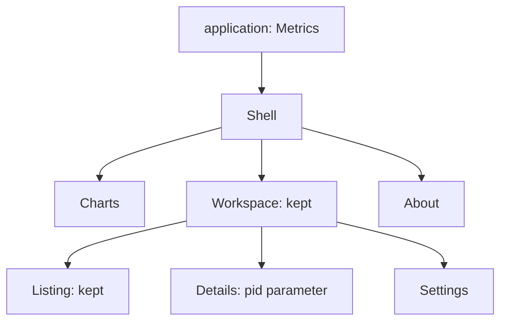

A window need not be one page with a route match inside it. Layouts mount
other layouts and pages, each with its own scope and local fields. This
example has a workspace with nested navigation, a permanent chart, a toolbar
and contextual help:



The diagram shows possible mounted children, not simultaneous routes:
`Shell` selects `Workspace` or `About`; `Workspace` selects one of its pages.
`Charts` is mounted independently of both outlets.

## Routes and shared data

Use `guinea::prelude::*` for the shared declarations:

<!-- shown: composition: routes and shared metrics -->
```rust
#[derive(Clone, PartialEq, Debug, guinea::Routable)]
pub enum Place {
    Workspace(InWorkspace),
    About,
}

#[derive(Default, Clone, PartialEq, Debug, guinea::Routable)]
pub enum InWorkspace {
    #[default]
    Listing,
    Details {
        pid: u32,
    },
    Settings,
}

#[derive(Default, Clone, PartialEq, Debug)]
pub struct Level(pub u32);

#[reducer]
fn level(this: &mut Level, by: u32) {
    this.0 += by;
}

feature! {
    pub Metrics {
        exports { Level }
    }
}

#[installs]
fn metrics(app: &mut FeatureBuilder) -> anyhow::Result<Metrics> {
    let level = app.state::<Level>().plain();
    app.repeat(std::time::Duration::from_secs(1), move || level.push(1));
    Ok(Metrics(level))
}
```
<!-- /shown -->

The outer route contains a nested route type. `navigate::<InWorkspace>()`
projects that level from the window's navigator; the inner layout does not
have to know `Place::Workspace`. It is not a second independent history.
`Metrics` is installed in the application and produces a level once per
second. Only `Charts` reads it.

## The shell and application

For WinUI, import `guinea::winui::{Layout, LayoutCx, Page, PageCx, UpdateCx,
Window, layout, page}`, `windows_reactor::{Button, StackPanel, TextBlock,
View}`, `std::cell::RefCell` and `std::rc::Rc`. The button helper is:

<!-- shown: winui: composition button helper -->
```rust
fn button(text: &'static str, run: impl Fn() + 'static) -> Button {
    Button::new()
        .on_click(run)
        .content(TextBlock::new().text(text))
}
```
<!-- /shown -->

For egui, import `guinea::eframe::{Layout, LayoutCx, Page, PageCx, Window,
layout, page}`. Both variants use the same shared declarations above.

::::backends
:::winui
<!-- shown: winui: composition shell -->
```rust
#[guinea::slot]
pub struct Toolbar;

#[guinea::slot]
pub struct Overlay;

#[derive(Default)]
pub struct Shell {
    last: Rc<RefCell<InWorkspace>>,
}

#[layout]
impl Layout for Shell {
    fn view(&self, cx: &mut LayoutCx<'_, '_, Self>) -> View {
        let nav = cx.navigate::<Place>();
        let about = nav.clone();
        let workspace = nav.clone();
        let remember = self.last.clone();
        let restore = self.last.clone();
        let toolbar = cx.slot::<Toolbar>();
        let overlay = cx.slot::<Overlay>();
        let charts = cx.mount::<Charts>(&());
        let content = cx.outlet(&nav, |place, cx| match place {
            Place::Workspace(_) => cx.mount::<Workspace>(&()).keep(),
            Place::About => cx.mount::<About>(&()),
        });
        StackPanel::new()
            .children((
                button("About", move || {
                    if let Some(Place::Workspace(level)) = about.current() {
                        *remember.borrow_mut() = level;
                    }
                    let _ = about.to(Place::About);
                }),
                button("Workspace", move || {
                    let _ = workspace.to(Place::Workspace(restore.borrow().clone()));
                }),
                charts,
                toolbar,
                content,
                overlay,
            ))
            .into()
    }
}

fn app(app: &mut FeatureBuilder) -> anyhow::Result<Window> {
    app.install::<Metrics>()?;
    Ok(Window::of::<Shell>().at(Place::Workspace(InWorkspace::Listing)))
}
```
<!-- /shown -->
:::
:::egui
<!-- shown: egui: composition shell -->
```rust
#[derive(Default)]
pub struct Shell {
    last: InWorkspace,
}

#[layout]
impl Layout for Shell {
    fn render(&mut self, cx: &mut LayoutCx<'_, Self>) {
        let nav = cx.navigate::<Place>();
        if cx.ui().button("About").clicked() {
            if let Some(Place::Workspace(level)) = nav.current() {
                self.last = level;
            }
            let _ = nav.to(Place::About);
        }
        if cx.ui().button("Workspace").clicked() {
            let _ = nav.to(Place::Workspace(self.last.clone()));
        }
        let charts = cx.mount::<Charts>(&());
        let content = cx.outlet(&nav, |place, cx| match place {
            Place::Workspace(_) => cx.mount::<Workspace>(&()).keep(),
            Place::About => cx.mount::<About>(&()),
        });
        charts.draw(cx.ui());
        content.draw(cx.ui());
    }
}

fn app(app: &mut FeatureBuilder) -> anyhow::Result<Window> {
    app.install::<Metrics>()?;
    Ok(Window::of::<Shell>().at(Place::Workspace(InWorkspace::Listing)))
}
```
<!-- /shown -->
:::
::::

`cx.mount::<Workspace>(&()).keep()` is the current keep syntax. When left
out of a mounting pass, that child sleeps instead of being removed. Its
local fields, features and mounted descendants remain allocated. Sleeping
does not stop every background operation; see [lifecycle](../lifecycle/).

Keeping an instance does not remember a route choice for you. Here the
About button explicitly saves the current nested route, and the Workspace
button restores it. That is application state, not an implicit effect of
`keep`. A persistent “last page” setting would need explicit storage too.

## A nested layout and a standalone part

::::backends
:::winui
<!-- shown: winui: composition workspace -->
```rust
#[derive(Default)]
pub struct Workspace;

#[layout]
impl Layout for Workspace {
    fn view(&self, cx: &mut LayoutCx<'_, '_, Self>) -> View {
        let nav = cx.navigate::<InWorkspace>();
        let listing = nav.clone();
        let settings = nav.clone();
        let seven = nav.clone();
        let eight = nav.clone();
        let broken = nav.clone();
        let content = cx.outlet(&nav, |place, cx| match place {
            InWorkspace::Listing => cx.mount::<Listing>(&()).keep(),
            InWorkspace::Details { pid } => cx.mount::<Details>(pid),
            InWorkspace::Settings => cx.mount::<Settings>(&()),
        });
        StackPanel::new()
            .children((
                button("Listing", move || {
                    let _ = listing.to(InWorkspace::Listing);
                }),
                button("Settings", move || {
                    let _ = settings.to(InWorkspace::Settings);
                }),
                button("Details 7", move || {
                    let _ = seven.to(InWorkspace::Details { pid: 7 });
                }),
                button("Details 8", move || {
                    let _ = eight.to(InWorkspace::Details { pid: 8 });
                }),
                button("Details 13", move || {
                    let _ = broken.to(InWorkspace::Details { pid: 13 });
                }),
                content,
            ))
            .into()
    }
}

#[derive(Default)]
pub struct Charts;

#[page]
impl Page for Charts {
    fn view(&self, cx: &mut PageCx<'_, '_, Self>) -> View {
        let (level, _) = cx.read::<Level>();
        TextBlock::new().text(format!("charts {}", level.0)).into()
    }
}
```
<!-- /shown -->
:::
:::egui
<!-- shown: egui: composition workspace -->
```rust
#[derive(Default)]
pub struct Workspace;

#[layout]
impl Layout for Workspace {
    fn render(&mut self, cx: &mut LayoutCx<'_, Self>) {
        let nav = cx.navigate::<InWorkspace>();
        if cx.ui().button("Listing").clicked() {
            let _ = nav.to(InWorkspace::Listing);
        }
        if cx.ui().button("Settings").clicked() {
            let _ = nav.to(InWorkspace::Settings);
        }
        if cx.ui().button("Details 7").clicked() {
            let _ = nav.to(InWorkspace::Details { pid: 7 });
        }
        if cx.ui().button("Details 8").clicked() {
            let _ = nav.to(InWorkspace::Details { pid: 8 });
        }
        if cx.ui().button("Details 13").clicked() {
            let _ = nav.to(InWorkspace::Details { pid: 13 });
        }
        let content = cx.outlet(&nav, |place, cx| match place {
            InWorkspace::Listing => cx.mount::<Listing>(&()).keep(),
            InWorkspace::Details { pid } => cx.mount::<Details>(pid),
            InWorkspace::Settings => cx.mount::<Settings>(&()),
        });
        content.draw(cx.ui());
    }
}

#[derive(Default)]
pub struct Charts;

#[page]
impl Page for Charts {
    fn render(&mut self, cx: &mut PageCx<'_, Self>) {
        let (level, _) = cx.read::<Level>();
        cx.ui().label(format!("charts {}", level.0));
    }
}
```
<!-- /shown -->
:::
::::

`Charts` is an ordinary page, not a special part trait. Mounting it gives
it a scope and its own dependency reads, even though no route points to it.
A sidebar chart, connection status strip or independently owned panel can
be composed this way. Placement in the toolkit's visual tree does not
require merging its state into the shell.

## Parameters are identity, not mutable inputs

A child is identified within its mounting parent by its type and equal
parameters. Mounting the same type with equal parameters reuses the same
instance. Different parameters create a different child; they do not call
`install` again on the old instance or mutate its fields.

Here each process detail page receives its PID on installation:

::::backends
:::winui
<!-- shown: winui: composition parameterized page and fill -->
```rust
pub struct Details {
    pid: u32,
    visits: u32,
    help: bool,
}

#[page]
impl Page for Details {
    type Params = u32;
    type Message = Edit;

    fn install(cx: &Install<u32>) -> anyhow::Result<Self> {
        anyhow::ensure!(*cx.params() != 13, "process is unavailable");
        Ok(Self {
            pid: *cx.params(),
            visits: 0,
            help: false,
        })
    }

    fn update(&mut self, message: Edit, _: &mut UpdateCx<'_, Self>) {
        match message {
            Edit::Visit => self.visits += 1,
            Edit::Help => self.help = !self.help,
        }
    }

    fn view(&self, cx: &mut PageCx<'_, '_, Self>) -> View {
        cx.fill::<Toolbar>(TextBlock::new().text(format!("tools {}", self.pid)).into());
        if self.help {
            cx.fill::<Overlay>(TextBlock::new().text("inspection help").into());
        }
        StackPanel::new()
            .children((
                TextBlock::new().text(format!("process {} visits {}", self.pid, self.visits)),
                Button::new()
                    .on_click(cx.on(|()| Edit::Visit))
                    .content(TextBlock::new().text("Inspect")),
                Button::new()
                    .on_click(cx.on(|()| Edit::Help))
                    .content(TextBlock::new().text("Help")),
            ))
            .into()
    }
}
```
<!-- /shown -->
:::
:::egui
<!-- shown: egui: composition parameterized page -->
```rust
pub struct Details {
    pid: u32,
    visits: u32,
    help: bool,
}

#[page]
impl Page for Details {
    type Params = u32;

    fn install(cx: &Install<u32>) -> anyhow::Result<Self> {
        anyhow::ensure!(*cx.params() != 13, "process is unavailable");
        Ok(Self {
            pid: *cx.params(),
            visits: 0,
            help: false,
        })
    }

    fn render(&mut self, cx: &mut PageCx<'_, Self>) {
        let ui = cx.ui();
        ui.label(format!("process {} visits {}", self.pid, self.visits));
        if ui.button("Inspect").clicked() {
            self.visits += 1;
        }
        if ui.button("Help").clicked() {
            self.help = !self.help;
        }
        if self.help {
            ui.label("inspection help");
        }
    }
}
```
<!-- /shown -->
:::
::::

Details pages are not kept, so leaving PID 7 for PID 8 removes the old
details instance. Returning to PID 7 starts its local visit counter at zero.
In contrast, the kept listing keeps its counter across inner navigation:

::::backends
:::winui
<!-- shown: winui: composition listing -->
```rust
#[derive(Default)]
pub struct Listing {
    visits: u32,
}

pub enum Edit {
    Visit,
    Help,
}

#[page]
impl Page for Listing {
    type Message = Edit;
    fn update(&mut self, _: Edit, _: &mut UpdateCx<'_, Self>) {
        self.visits += 1;
    }
    fn view(&self, cx: &mut PageCx<'_, '_, Self>) -> View {
        StackPanel::new()
            .children((
                TextBlock::new().text(format!("listing visits {}", self.visits)),
                Button::new()
                    .on_click(cx.on(|()| Edit::Visit))
                    .content(TextBlock::new().text("Select row")),
            ))
            .into()
    }
}
```
<!-- /shown -->
:::
:::egui
<!-- shown: egui: composition listing -->
```rust
#[derive(Default)]
pub struct Listing {
    visits: u32,
}

#[page]
impl Page for Listing {
    fn render(&mut self, cx: &mut PageCx<'_, Self>) {
        cx.ui().label(format!("listing visits {}", self.visits));
        if cx.ui().button("Select row").clicked() {
            self.visits += 1;
        }
    }
}
```
<!-- /shown -->
:::
::::

The two plain destination pages complete the example:

::::backends
:::winui
<!-- shown: winui: composition plain pages -->
```rust
#[derive(Default)]
pub struct About;

#[page]
impl Page for About {
    fn view(&self, _: &mut PageCx<'_, '_, Self>) -> View {
        TextBlock::new().text("about the application").into()
    }
}

#[derive(Default)]
pub struct Settings;

#[page]
impl Page for Settings {
    fn view(&self, _: &mut PageCx<'_, '_, Self>) -> View {
        TextBlock::new().text("workspace settings").into()
    }
}
```
<!-- /shown -->
:::
:::egui
<!-- shown: egui: composition plain pages -->
```rust
#[derive(Default)]
pub struct About;

#[page]
impl Page for About {
    fn render(&mut self, cx: &mut PageCx<'_, Self>) {
        cx.ui().label("about the application");
    }
}

#[derive(Default)]
pub struct Settings;

#[page]
impl Page for Settings {
    fn render(&mut self, cx: &mut PageCx<'_, Self>) {
        cx.ui().label("workspace settings");
    }
}
```
<!-- /shown -->
:::
::::

Do not expect two mounts of one type with equal parameters under the same
parent to make two independent widgets. Give them distinct role parameters
or types when they need independent identity.

## Slots and ownership

WinUI's `#[guinea::slot]` declares a marker. A layout places it using
`cx.slot::<S>()`; a descendant fills it with `cx.fill::<S>(view)`. The
details page above fills the shell's toolbar and, conditionally, its help
slot. The fill belongs to that page and is withdrawn when it stops filling,
sleeps or leaves. `slot_or` supplies a fallback when no active fill exists.
An unplaced fill is an error, not an implicit global portal.

A slot changes where content is presented; it does not create a scope for
an arbitrary view. If content needs independent page state and reads,
mount it as a page, like `Charts`, and place its child view where needed.

**Backend boundary:** the current egui adapter has no `slot`/`fill` API.
Its version renders help inside the details page. A parent-owned egui
overlay needs explicit application composition; the WinUI slot calls
cannot simply be copied there.

## Checking the preserved instances

The backend harness only drives this example; these tests specify the
composition's behavior, not a separate semantic testing framework:

::::backends
:::winui
<!-- shown: winui: composition preserves the right instances -->
```rust
#[guinea::test(iterations = 4)]
fn keep_and_parameters_choose_which_local_state_survives(h: &mut Harness) {
    let window = h.app(app).unwrap();
    let mut ui = Mounted::<Place>::from_window(h, window).unwrap();
    ui.settle();
    ui.click_text("Select row").settle();
    ui.click_text("Settings").settle();
    ui.click_text("Listing").settle();
    assert!(ui.find_text("listing visits 1").is_some());

    ui.click_text("Details 7").settle();
    ui.click_text("Inspect").settle();
    ui.click_text("About").settle();
    ui.click_text("Workspace").settle();
    assert!(ui.find_text("process 7 visits 1").is_some());
    ui.click_text("Details 8").settle();
    assert!(ui.find_text("process 8 visits 0").is_some());
    ui.click_text("Details 7").settle();
    assert!(ui.find_text("process 7 visits 0").is_some());
}
```
<!-- /shown -->
:::
:::egui
<!-- shown: egui: composition preserves the right instances -->
```rust
#[guinea::test(iterations = 4)]
fn keep_and_parameters_choose_which_local_state_survives(h: &mut Harness) {
    let window = h.app(app).unwrap();
    let mut ui = Mounted::window(h, window);
    ui.click_text("Select row");
    ui.click_text("Settings");
    ui.click_text("Listing");
    assert!(ui.has_text("listing visits 1"));

    ui.click_text("Details 7");
    ui.click_text("Inspect");
    ui.click_text("About");
    ui.click_text("Workspace");
    assert!(ui.has_text("process 7 visits 1"));
    ui.click_text("Details 8");
    assert!(ui.has_text("process 8 visits 0"));
    ui.click_text("Details 7");
    assert!(ui.has_text("process 7 visits 0"));
}
```
<!-- /shown -->
:::
::::

## Independent redraws: a WinUI guarantee

Under WinUI, `Charts` is its own Reactor component. Only it reads `Level`,
so a metrics update does not require rebuilding `Shell`. A changed slot
fill also updates its placeholder without rebuilding the placing layout.
The test version counts calls at the start of `Shell::view`:

<!-- shown: winui: composition redraw probe -->
```rust
thread_local! {
    static SHELL_DRAWS: Cell<u32> = const { Cell::new(0) };
}
```
<!-- /shown -->

<!-- shown: winui: composition keeps redraws local -->
```rust
#[guinea::test(iterations = 4)]
fn metrics_and_slot_updates_do_not_rebuild_the_shell(h: &mut Harness) {
    let window = h.app(app).unwrap();
    let mut ui = Mounted::<Place>::from_window(h, window).unwrap();
    ui.settle();
    ui.click_text("Details 7").settle();
    let before = SHELL_DRAWS.get();
    ui.click_text("Help").settle();
    assert!(ui.find_text("inspection help").is_some());
    assert_eq!(SHELL_DRAWS.get(), before);
    h.advance(std::time::Duration::from_secs(1));
    ui.settle();
    assert!(ui.find_text("charts 1").is_some());
    assert_eq!(SHELL_DRAWS.get(), before);
    ui.click_text("About").settle();
    assert!(ui.find_text("inspection help").is_none());
    assert!(ui.find_text("tools 7").is_none());
    ui.click_text("Workspace").settle();
    assert!(ui.find_text("inspection help").is_some());
    ui.click_text("Settings").settle();
    assert!(ui.find_text("inspection help").is_none());
    assert!(ui.find_text("tools 7").is_none());
}
```
<!-- /shown -->

The egui version keeps the same scope and state boundaries, but it renders
immediately each frame. It does not promise that only the chart's render
function runs when metrics change. Scope independence and retained-mode
redraw independence are different contracts.

## Failed mounting and navigation

An outlet which cannot install its next child keeps its previous child
and restores the navigator's previous route; the failure is available
through `nav.failure()`. If nothing has mounted yet, it shows a failure
instead. A leave guard may also prevent a transition. Do not record a
successful route change or dispose unrelated parts just because `to` was
called: navigation and successful mounting are separate steps.

The example deliberately rejects PID 13 in `install`. Both backends check
that navigating to it leaves PID 7's existing page and counter intact:

::::backends
:::winui
<!-- shown: winui: composition failed installation -->
```rust
#[guinea::test(iterations = 4)]
fn a_failed_details_install_keeps_the_previous_page_and_its_local_state(h: &mut Harness) {
    let window = h.app(app).unwrap();
    let mut ui = Mounted::<Place>::from_window(h, window).unwrap();
    ui.settle();
    ui.click_text("Details 7").settle();
    ui.click_text("Inspect").settle();
    ui.click_text("Details 13").settle();
    assert!(ui.find_text("process 7 visits 1").is_some());
    assert_eq!(
        ui.route(),
        Place::Workspace(InWorkspace::Details { pid: 7 })
    );
}
```
<!-- /shown -->
:::
:::egui
<!-- shown: egui: composition failed installation -->
```rust
#[guinea::test(iterations = 4)]
fn a_failed_details_install_keeps_the_previous_page_and_its_local_state(h: &mut Harness) {
    let window = h.app(app).unwrap();
    let mut ui = Mounted::window(h, window);
    ui.click_text("Details 7");
    ui.click_text("Inspect");
    ui.click_text("Details 13");
    assert!(ui.has_text("process 7 visits 1"));
}
```
<!-- /shown -->
:::
::::
