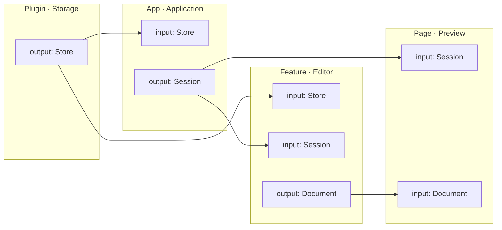
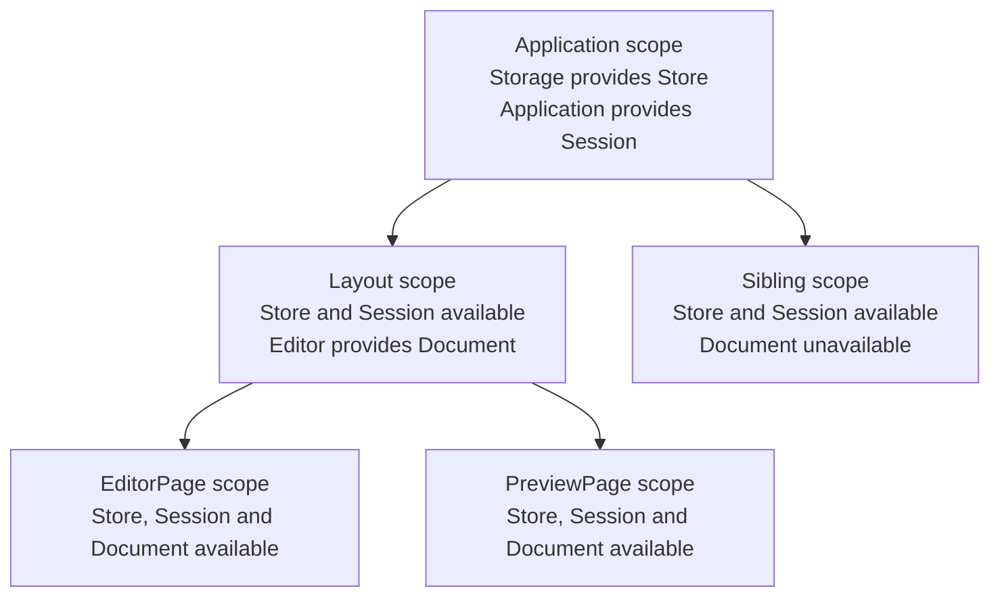

Each part of an application declares its contract:

- **Inputs** are installer arguments.
- **Outputs** are listed in `provides` and returned by the installer.



`Storage` opens the store. `Application` creates a session. `Editor` receives
the store and session, opens a document and makes it available to its
descendants. The label at an arrow's source is an output; at its destination,
an input.

## Inputs and outputs

`Store`, `Session`, `Document` and `StorageConfig` are application types.
This teaching example uses an in-memory store; `open_store`, `Session::new`
and `Document::open` represent the code working with those resources.
The shared code imports `guinea::prelude::*`.

A plugin takes explicit configuration and returns its declared output:

<!-- shown: dependencies: plugin outputs -->
```rust
plugin! {
    pub Storage {
        provides { Store }
    }
}

#[builds]
fn storage(_app: &mut PluginBuilder, config: StorageConfig) -> anyhow::Result<Storage> {
    Ok(Storage(open_store(config)?))
}
```
<!-- /shown -->

The first argument after `PluginBuilder` configures this instance. Any
subsequent arguments are dependencies. After successful installation,
guinea automatically publishes the values declared in `provides`.

An application-level feature receives `Store` and provides `Session`:

<!-- shown: dependencies: application inputs and outputs -->
```rust
feature! {
    pub Application {
        provides { Session }
    }
}

#[installs]
fn application(_app: &mut FeatureBuilder, store: Store) -> anyhow::Result<Application> {
    Ok(Application(Session::new(store)))
}
```
<!-- /shown -->

A regular feature declares its contract in the same way:

<!-- shown: dependencies: feature inputs and outputs -->
```rust
feature! {
    pub Editor {
        provides { Document }
    }
}

#[installs]
fn editor(_cx: &Install, store: Store, session: Session) -> anyhow::Result<Editor> {
    Ok(Editor(Document::open(store, session)?))
}
```
<!-- /shown -->

There is no manual registration or context lookup. Guinea passes a clone
of the value; its type determines whether cloning shares a resource or
copies data.

## Installation order

Declaring an input **does not install its provider**. The application code
sets the order:

<!-- shown: dependencies: application wiring -->
```rust
pub fn app(app: &mut FeatureBuilder) -> anyhow::Result<Store> {
    let Storage(store) = app.plugin::<Storage>(StorageConfig("Notes"))?;
    app.install::<Application>()?;
    Ok(store)
}
```
<!-- /shown -->

Returning `Store` from `app` is optional: here it lets a test keep the handle
without a context lookup. `Storage` publishes the dependency; returning it
from the plain `app` function does not.

## Pages and layouts

Pages and layouts declare inputs as `install` arguments. This part is the
same across backends; rendering is omitted from the following blocks.
Import `Page`, `Layout`, `page` and `layout` from the chosen backend.

The layout receives the session and installs `Editor` in its own scope:

<!-- shown: dependencies: layout installation -->
```rust
struct WorkspaceLayout {
    session: Session,
    document: Document,
}

#[layout]
impl Layout for WorkspaceLayout {
    fn install(cx: &Install, session: Session) -> anyhow::Result<Self> {
        let Editor(document) = cx.install::<Editor>(&())?;
        Ok(Self { session, document })
    }
}
```
<!-- /shown -->

The page mounted by this layout receives the session and document:

<!-- shown: dependencies: page installation -->
```rust
struct EditorPage {
    session: Session,
    document: Document,
}

#[page]
impl Page for EditorPage {
    fn install(_cx: &Install, session: Session, document: Document) -> anyhow::Result<Self> {
        Ok(Self { session, document })
    }
}
```
<!-- /shown -->

A page or layout's `install` returns the component itself, not an output
declaration. Here `Editor`, installed by the layout, provides `Document`.
The layout mounts `EditorPage` and `PreviewPage`; both receive `Session`
and `Document`. A page can also install its own features with `cx.install`,
but does not itself mount child pages.

## Values follow the scope tree

The first diagram shows declaration dependencies. The scope tree determines
where their values are available:



An output is available in its provider's scope and descendants, not in
sibling branches. New outputs extend the environment rather than replacing
inherited dependencies. Removing a scope releases the values it owns;
handle copies retained elsewhere follow their type's ownership rules.

## Wiring errors

Guinea collects declarations through `inventory` and validates them
**at startup, before application installation**. It checks for missing or
conflicting providers, inconsistent inputs, duplicate outputs and cycles.
Before installation, it also checks that inputs are available in the scope.

This is not compile-time graph evaluation or function-body analysis.
Checks requiring a concrete generic specialization are deferred until its
installation. Validation does not reconstruct page mounting or call order
from application code.

| Situation | Result |
| --- | --- |
| A resource cannot be created or opened | `Err`, propagated with `?` if appropriate |
| Dependencies are wired incorrectly | Panic with a tree of diagnostics |
| `Option<T>` input, no declared provider | `None` |
| `Option<T>` input, value available | `Some(value)` |
| `Option<T>` input, provider declared but value unavailable | Panic |

`Option<T>` allows a dependency to be absent from the program's composition;
it does not hide a wiring error.

## Substituting dependencies in tests

Use one provider declaration with different configuration for production
and tests: open a real connection or accept a prepared client. Two concrete
declarations providing the same type in one executable conflict even when
only one is installed. Alternatively, exclude declarations from the build
with `cfg`.

Keep assertion handles from `app.plugin` or your `app` function's return
value. Unlike normal startup, `Harness` does not run global declaration
validation automatically. Call `guinea::app::validate_declarations()`
explicitly when testing the application's declared composition.

Next: [installing plugins](../plugins/) and [pages and layouts](../pages/).
