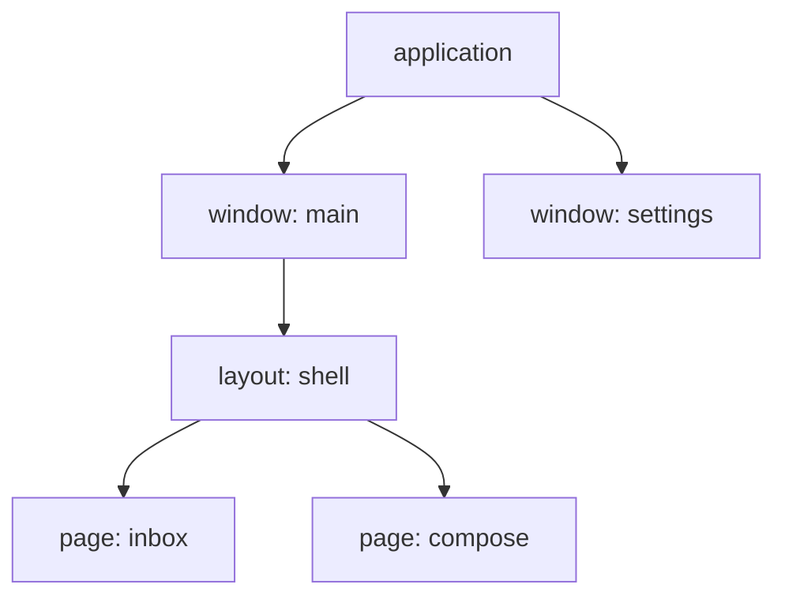

Everything a feature sets up - its state, its actors, their timers and
background work, what it hears on the bus - lives in a **scope**, and goes
when the scope goes. Scopes form a tree that follows the screen:



The application's scope lives as long as the process. A window's lives while
the window is open. A layout's and a page's live while the router has them
mounted: navigating away from a page removes its scope, and everything under
it, children first.

An application does not create scopes. The router does, as the user moves
around; what the application decides is **where each feature is installed**.

## Installed higher, shared below

A layout installs a feature the pages under it all need:

<!-- shown: scopes: a feature the layout installs -->
```rust
#[derive(Default, Clone, PartialEq, Debug)]
pub struct Unread(pub u32);

#[reducer]
fn unread(this: &mut Unread, arrived: u32) {
    this.0 += arrived;
}

pub struct Arrived;

#[derive(Debug)]
pub struct Mailbox {
    push: Push<Unread>,
}

actor! {
    Mailbox {
        handlers { Arrived }
    }
}

#[handler]
fn arrived(In(this, Arrived, _): In<Mailbox, Arrived>) {
    this.push.send(1);
}

feature! {
    pub Inbox {
        exports { Unread }
    }
}

#[installs]
fn inbox(cx: &Install) -> anyhow::Result<Inbox> {
    let (unread, _) = cx.state::<Unread>().driven_by(|push| Mailbox { push });
    Ok(Inbox(unread))
}
```
<!-- /shown -->

`exports { Unread }` is what makes `Unread` readable below. A page under the
layout reads it and acts on it as if it were its own, and the actions go to
the feature that owns it:

<!-- shown: scopes: a page reads what the layout exports -->
```rust
#[guinea::test]
fn a_page_reads_what_the_layout_above_exports(h: &mut Harness) {
    h.install::<Inbox>(&()).unwrap();
    let page = h.child();

    page.dispatch::<Unread>().emit(Arrived);
    h.settled();

    assert_eq!(page.state::<Unread>().0, 1);
    assert_eq!(h.state::<Unread>().0, 1);
}
```
<!-- /shown -->

In a test the harness stands in for the tree: `h` is the layout and
`h.child()` a page under it, with no window and no router.

## Leaving ends it

A page installs what only it needs. This one saves a draft every second:

<!-- shown: scopes: a feature the page installs -->
```rust
#[installs]
fn composing(cx: &Install<Rc<Cell<u32>>>) -> anyhow::Result<Composing> {
    let draft = cx.state::<Draft>().plain();

    let saved = cx.params().clone();
    cx.repeat(Duration::from_secs(1), move || saved.set(saved.get() + 1));

    Ok(Composing(draft))
}
```
<!-- /shown -->

Nothing in it says when to stop. The timer belongs to the page's scope, and
leaving the page removes the scope:

<!-- shown: scopes: leaving a page ends what it started -->
```rust
#[guinea::test]
fn leaving_a_page_ends_what_it_started(h: &mut Harness) {
    h.install::<Inbox>(&()).unwrap();
    let saved = Rc::new(Cell::new(0));

    let page = h.child();
    page.install::<Composing>(&saved).unwrap();
    h.advance(Duration::from_secs(3));
    assert_eq!(saved.get(), 3);

    page.leave();
    h.advance(Duration::from_secs(3));
    assert_eq!(saved.get(), 3);

    h.dispatch::<Unread>().emit(Arrived);
    h.settled();
    assert_eq!(h.state::<Unread>().0, 1);
}
```
<!-- /shown -->

The same holds for everything else the page set up: its actors are disposed,
their background work is cancelled, its subscriptions are dropped. The layout
above carries on untouched. There is no teardown to write and none to forget.
For something guinea does not know about - a handle from another library -
`cx.on_teardown` runs a closure when the scope goes.

## Nothing goes up

Reading only goes down. What a page claims, the layout above it cannot see,
and neither can a page beside it:

<!-- shown: scopes: what a page claims is not seen above it -->
```rust
#[guinea::test]
fn what_a_page_claims_is_not_seen_above_it(h: &mut Harness) {
    let page = h.child();
    page.install::<Composing>(&Rc::default()).unwrap();

    assert_eq!(page.scope().owner_of::<Draft>(), Some(page.scope()));
    assert_eq!(h.segment().scope().owner_of::<Draft>(), None);
}
```
<!-- /shown -->

So when two pages need the same state, it goes into the layout they share,
and when two windows do, into the application. The rule of thumb: install a
feature in the lowest scope that is above everyone who reads it. Lower, and
someone cannot reach it; higher, and it outlives the screen it was for.

That is also what keeps a test small. A page can reach only what it installed,
what the layouts above export and what the application provides, so a test
sets up exactly that and nothing else.

## For plugin and backend authors

A `Scope` is a name, not an owner: it is `Copy`, and the `ScopeTree` holds what
each scope keeps. Holding a `Scope` does not keep it alive, and a removed
scope's name never comes back - `is_alive` says whether it is still there.
