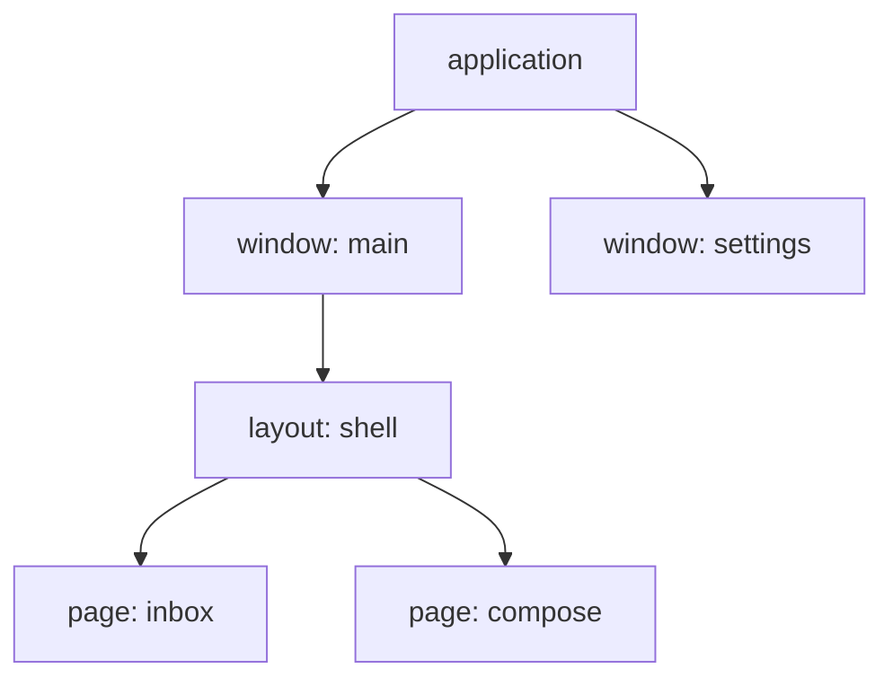

A **scope** determines how long resources live. Features installed in it
register state, actors, timers, background tasks and subscriptions. Removing
the scope releases those resources.

Applications, windows, layouts and pages have their own scopes, arranged in
a tree:



The application's scope lives with its `GuineaHost`. The backend creates
window scopes beneath it; mounting layouts and pages adds further levels.
Removing a parent removes its whole subtree, children before parents.

Navigating away normally removes a page's scope. A page mounted with `keep`
instead keeps its scope asleep until it is needed again. The examples below
do not use `keep`.

When working with pages, mounting creates the scopes for you. You choose
where each feature is installed. That choice determines its resources'
lifetime and who can read its state.

## Shared state in a parent scope

A feature used by several pages can be installed in their common layout.
For example, every mail page can read the unread count:

<!-- shown: scopes: a feature the layout installs -->
```rust
#[derive(Default, Clone, PartialEq, Debug)]
pub struct Unread(pub u32);

#[reducer]
fn unread(this: &mut Unread, arrived: u32) {
    this.0 += arrived;
}

pub struct Arrived;

#[derive(Debug)]
pub struct Mailbox {
    push: Push<Unread>,
}

actor! {
    Mailbox {
        handlers { Arrived }
    }
}

#[handler]
fn arrived(In(this, Arrived, _): In<Mailbox, Arrived>) {
    this.push.send(1);
}

feature! {
    pub Inbox {
        exports { Unread }
    }
}

#[installs]
fn inbox(cx: &Install) -> anyhow::Result<Inbox> {
    let (unread, _) = cx.state::<Unread>().driven_by(|push| Mailbox { push });
    Ok(Inbox(unread))
}
```
<!-- /shown -->

`exports { Unread }` makes `Unread` readable from child scopes. The page reads
the layout's state and gets a dispatcher for its owning feature, so the same
`Mailbox` handles the `Arrived` action:

<!-- shown: scopes: a page reads what the layout exports -->
```rust
#[guinea::test]
fn a_page_reads_what_the_layout_above_exports(h: &mut Harness) {
    h.install::<Inbox>(&()).unwrap();
    let page = h.child();

    page.dispatch::<Unread>().emit(Arrived);
    h.settled();

    assert_eq!(page.state::<Unread>().0, 1);
    assert_eq!(h.state::<Unread>().0, 1);
}
```
<!-- /shown -->

In this test, `h` represents the layout's scope and `h.child()` creates a
child scope for the page. The harness checks state access without a window
or router.

## Removing a scope stops its work

Install the draft-editing feature on the page itself. The example simulates
autosaving with a timer that increments `saved` every second. It does not
write a file: the behavior under test is the timer's lifetime.

<!-- shown: scopes: a feature the page installs -->
```rust
#[installs]
fn composing(cx: &Install<Rc<Cell<u32>>>) -> anyhow::Result<Composing> {
    let draft = cx.state::<Draft>().plain();

    let saved = cx.params().clone();
    cx.repeat(Duration::from_secs(1), move || saved.set(saved.get() + 1));

    Ok(Composing(draft))
}
```
<!-- /shown -->

Installation starts the timer without keeping a handle to stop it. The
page's scope owns it. Check that the counter stops advancing once that scope
is removed:

<!-- shown: scopes: leaving a page ends what it started -->
```rust
#[guinea::test]
fn leaving_a_page_ends_what_it_started(h: &mut Harness) {
    h.install::<Inbox>(&()).unwrap();
    let saved = Rc::new(Cell::new(0));

    let page = h.child();
    page.install::<Composing>(&saved).unwrap();
    h.advance(Duration::from_secs(3));
    assert_eq!(saved.get(), 3);

    page.leave();
    h.advance(Duration::from_secs(3));
    assert_eq!(saved.get(), 3);

    h.dispatch::<Unread>().emit(Arrived);
    h.settled();
    assert_eq!(h.state::<Unread>().0, 1);
}
```
<!-- /shown -->

Removing the scope also disposes its actors, cancels their background work
and ends its subscriptions. The parent keeps running: the test's `Inbox`
feature still handles `Arrived`.

## Keeping an external resource until the page leaves

Suppose a page creates thumbnails in a temporary directory. They are needed
while the page is open, but should be deleted when it leaves. The `tempfile`
crate provides `TempDir`, which removes its directory and contents when
dropped. guinea does not know about this object unless you give it ownership.

<!-- shown: scopes: a temporary cache belongs to the page -->
```rust
feature! {
    pub PreviewCache {}
}

#[installs]
fn preview_cache(cx: &Install<Path>) -> anyhow::Result<PreviewCache> {
    let cache = tempfile::Builder::new()
        .prefix("previews-")
        .tempdir_in(cx.params())?;
    cx.on_teardown(move || drop(cache));
    Ok(PreviewCache)
}
```
<!-- /shown -->

`cx.params()` supplies the parent directory; installation creates a separate
cache beneath it. This example needs `tempfile` in the application's
dependencies.

Leaving `cache` as a local variable would delete the directory as soon as
installation returns. Instead, the `move` closure takes ownership of the
`TempDir`, and `cx.on_teardown` keeps the closure until the scope is removed.
Calling it drops the guard and lets `tempfile` perform its cleanup.

The test writes a file there and checks that leaving removes the cache and
its contents, but not the parent directory:

<!-- shown: scopes: leaving deletes the temporary cache -->
```rust
#[guinea::test]
fn leaving_a_page_deletes_its_temporary_cache(h: &mut Harness) {
    let parent = tempfile::tempdir().unwrap();
    let page = h.child();
    page.install::<PreviewCache>(parent.path()).unwrap();

    let entries: Vec<_> = std::fs::read_dir(parent.path())
        .unwrap()
        .map(|entry| entry.unwrap().path())
        .collect();
    assert_eq!(entries.len(), 1);
    let cache = &entries[0];
    let thumbnail = cache.join("thumbnail.bin");
    std::fs::write(&thumbnail, b"preview").unwrap();
    assert!(thumbnail.exists());

    page.leave();

    assert!(!cache.exists());
    assert!(parent.path().exists());
}
```
<!-- /shown -->

The feature's returned value is not kept by the test. The scope owns the
cleanup, so the cache still survives installation. The same pattern works
for a subscription guard from another library: move it into the teardown
closure and drop it there. If the library instead requires an explicit
`unsubscribe` or `close` call, make that call in the closure.

## Looking up state

A read starts in the page's own scope. If the state is not there, lookup
walks through its ancestors to the nearest scope that exports it. It never
searches children or siblings. The draft is therefore available on the page
but not in its parent layout:

<!-- shown: scopes: what a page claims is not seen above it -->
```rust
#[guinea::test]
fn what_a_page_claims_is_not_seen_above_it(h: &mut Harness) {
    let page = h.child();
    page.install::<Composing>(&Rc::default()).unwrap();

    assert_eq!(page.scope().owner_of::<Draft>(), Some(page.scope()));
    assert_eq!(h.segment().scope().owner_of::<Draft>(), None);
}
```
<!-- /shown -->

For shared state, choose the readers' nearest common ancestor: a layout for
several pages, or the application for several windows. Installed lower, the
feature's state is out of reach of some readers. Installed higher, its
resources live longer than needed.

A page test supplies those same dependencies: its own features, the ancestor
exports it uses and the application data it needs. Other windows and sibling
pages need not be created.
