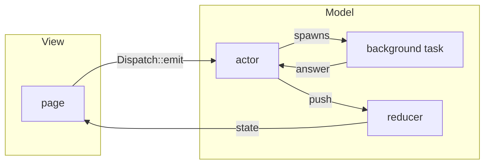

A GUI toolkit provides windows, controls and input handling. An application
also needs state, background work, navigation and saved settings. Each project
has to decide how those fit together with its interface.

As the application grows, the same questions come up:

- How does a user action reach its handler without a chain of forwarded
  messages?
- How do you prevent an old request's answer from overwriting a newer result?
- Who stops a screen's tasks and subscriptions when the user closes it?
- Where does state shared by several screens belong?
- How do you test application logic without starting the interface?
- How do you save settings and report their changes?

guinea provides a structure for that application. It connects the interface
to application logic and manages resource lifetimes. The interface itself
stays in the chosen toolkit: WinUI, iced, egui, ratatui or Slint.

## What guinea is

guinea is built around MVI: user actions, application state and presentation
are separate, and changes follow a defined path.

- **Intent** - an action a page sends on the user's behalf: add a task,
  refresh a list, save a document.
- **Model** - state and the logic that changes it. An actor handles actions,
  and a reducer applies the updates it prepares to the state.
- **View** - a page that reads the state and builds the interface using its
  toolkit.

When an action needs background work, the flow looks like this:



1. The page sends an action through `Dispatch::emit`.
2. The actor handles it and starts a background task, such as a server request
   or a file read. The result comes back to the actor as a message.
3. The actor sends an update, and the reducer changes the state.
4. The page reads the result and updates the interface.

A simple action needs no background task: the actor can send an update
straight away. Data that only the page needs stays in the page's own struct.
A filter's text or a selected tab need not pass through an actor and reducer.

## State and lifetime

Application logic is grouped into **features**. A feature installs its state,
handlers, subscriptions and background work into a **scope**, an area with a
defined lifetime. Applications, windows, layouts and pages have their own
scopes.

Removing a page's scope releases its resources: background tasks are
cancelled, timers stop and subscriptions end. Resources managed by guinea
need no separate teardown code.

Where a feature is installed determines who can read its state and how long
it lives. A list used by one page can be installed on that page. Several
pages share it through their common layout; several windows, through the
application.

A page reads its own features' state, the exports of parent layouts and the
data the application provides. A test supplies those same dependencies: it
can install the feature, send an action and check the result without the
rest of the application.

## Two layers

The book has two parts:

- **Application layer** — [scopes](../concepts/scopes/),
  [features and state](../concepts/features/), plugins, actors, communication
  and background work. These rules do not depend on the GUI toolkit.
- **Backend integration** — [pages and layouts](../concepts/pages/) and
  [interface composition](../concepts/composition/): attaching application
  logic to windows, reading state from the UI, routing, mounting and
  redraws. Examples use backend tabs and call out differences rather than
  assuming every adapter has the same API.

Start with the application layer to define behavior and test it without a
window. Use the integration part when connecting that behavior to a toolkit.
An application-layer example may mention a page as a resource owner; the
toolkit-specific mounting and rendering code belongs in the second part.

## A first look

Here is a counter feature. `Count` holds the value, the reducer adds a number
to it, and the `Counting` actor handles the `Add` action. The `counter`
function creates the state and actor when the feature is installed.

<!-- shown: introduction: a feature -->
```rust
#[derive(Default, Clone, PartialEq, Debug)]
pub struct Count(pub u32);

#[reducer]
fn count(this: &mut Count, by: u32) {
    this.0 += by;
}

pub struct Add(pub u32);

#[derive(Debug)]
pub struct Counting {
    push: Push<Count>,
}

actor! {
    Counting {
        handlers { Add }
    }
}

#[handler]
fn add(In(this, Add(by), _): In<Counting, Add>) {
    this.push.send(by);
}

feature! {
    pub Counter {
        exports { Count }
    }
}

#[installs]
fn counter(cx: &Install) -> anyhow::Result<Counter> {
    let (count, _) = cx.state::<Count>().driven_by(|push| Counting { push });
    Ok(Counter(count))
}
```
<!-- /shown -->

A test installs the counter and sends two `Add` actions, just as a page
would. Once the actions have been processed, it checks `Count`. No window
or GUI event loop is needed.

<!-- shown: introduction: a test -->
```rust
#[guinea::test]
fn what_is_added_is_counted(h: &mut Harness) {
    h.install::<Counter>(&()).unwrap();

    h.dispatch::<Count>().emit(Add(2));
    h.dispatch::<Count>().emit(Add(3));
    h.settled();

    assert_eq!(h.state::<Count>().0, 5);
}
```
<!-- /shown -->
