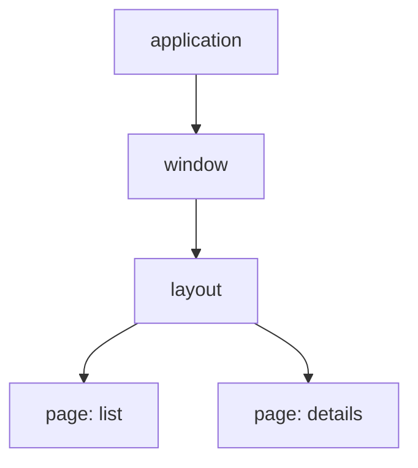

Rust has good toolkits and no application layer above them. The architecture is
left to you, so you borrow one from GC languages, and Rust's ownership fights
it. What is left is wiring - not the same in every toolkit, but no application
past a demo escapes it:

- messages forwarded through layers to where they are handled;
- request ids, so a late answer does not overwrite a newer one;
- setup, teardown and refetching written by hand for every screen;
- one huge state everything reaches into, and no tests for it;
- handles threaded through constructors, and a `clone()` before every `move`;
- settings saved and synced by hand.

## What guinea is

MVI for a whole application:

- **Intent** - a page emits what the user asked for, and changes only its own
  view state;
- **Model** - a reducer, the one place a state changes, driven by an actor that
  decides;
- **View** - the page, written the way its toolkit works: WinUI, iced, egui,
  ratatui or Slint.

The application is built out of pages. Everything lives in a scope - the
application's, a window's, a layout's, a page's - and goes with it: what a page
set up ends when the user leaves it, with nothing to tear down by hand.



State lives with the screen that needs it, and is shared by installing it
higher up - in a layout, or in the application. A page reads what it installed
itself, what a layout above it exports, and what the application provides;
anything else is not in reach, and a test sets up exactly that and no more.

## A first look

A counter: the state, the reducer that is the only place it changes, the actor
that decides what goes into it, and the feature that installs the two.

<!-- shown: introduction: a feature -->
```rust
#[derive(Default, Clone, PartialEq, Debug)]
pub struct Count(pub u32);

#[reducer]
fn count(this: &mut Count, by: u32) {
    this.0 += by;
}

pub struct Add(pub u32);

#[derive(Debug)]
pub struct Counting {
    push: Push<Count>,
}

actor! {
    Counting {
        handlers { Add }
    }
}

#[handler]
fn add(In(this, Add(by), _): In<Counting, Add>) {
    this.push.send(by);
}

feature! {
    pub Counter {
        exports { Count }
    }
}

#[installs]
fn counter(cx: &FeatureInitContext) -> anyhow::Result<Counter> {
    let (count, _) = cx.state::<Count>().driven_by(|push| Counting { push });
    Ok(Counter(count))
}
```
<!-- /shown -->

A test installs the feature with nothing around it, sends what a page would,
and reads what came out. No window, no event loop.

<!-- shown: introduction: a test -->
```rust
#[guinea::test]
fn what_is_added_is_counted(h: &mut Harness) {
    h.install::<Counter>(&()).unwrap();

    h.dispatch::<Count>().emit(Add(2));
    h.dispatch::<Count>().emit(Add(3));
    h.settled();

    assert_eq!(h.state::<Count>().0, 5);
}
```
<!-- /shown -->
