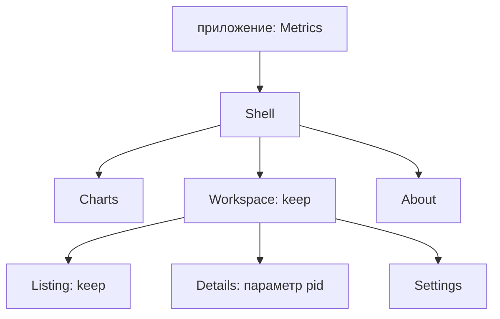

Окно не обязано быть одной страницей с `match` маршрутов внутри.
Лейауты монтируют другие лейауты и страницы, у каждого свои скоуп
и локальные поля. В примере есть рабочая область с вложенной навигацией,
постоянный график, панель инструментов и контекстная справка:



Схема показывает возможных потомков, а не одновременные маршруты:
`Shell` выбирает `Workspace` или `About`, а `Workspace` — одну
из своих страниц. `Charts` монтируется независимо от обоих outlet.

## Маршруты и общие данные

Общие объявления используют `guinea::prelude::*`:

<!-- shown: composition: routes and shared metrics -->
```rust
#[derive(Clone, PartialEq, Debug, guinea::Routable)]
pub enum Place {
    Workspace(InWorkspace),
    About,
}

#[derive(Default, Clone, PartialEq, Debug, guinea::Routable)]
pub enum InWorkspace {
    #[default]
    Listing,
    Details {
        pid: u32,
    },
    Settings,
}

#[derive(Default, Clone, PartialEq, Debug)]
pub struct Level(pub u32);

#[reducer]
fn level(this: &mut Level, by: u32) {
    this.0 += by;
}

feature! {
    pub Metrics {
        exports { Level }
    }
}

#[installs]
fn metrics(app: &mut FeatureBuilder) -> anyhow::Result<Metrics> {
    let level = app.state::<Level>().plain();
    app.repeat(std::time::Duration::from_secs(1), move || level.push(1));
    Ok(Metrics(level))
}
```
<!-- /shown -->

Внешний маршрут содержит вложенный тип маршрута. Вызов
`navigate::<InWorkspace>()` получает проекцию этого уровня из навигатора
окна: внутреннему лейауту не нужно знать `Place::Workspace`.
Это не вторая независимая история переходов. Фича `Metrics`
устанавливается в приложении и обновляет значение раз в секунду.
Читает его только `Charts`.

## Оболочка и приложение

Для WinUI нужны импорты `guinea::winui::{Layout, LayoutCx, Page, PageCx,
UpdateCx, Window, layout, page}`, `windows_reactor::{Button, StackPanel,
TextBlock, View}`, `std::cell::RefCell` и `std::rc::Rc`.
Хелпер создания кнопки:

<!-- shown: winui: composition button helper -->
```rust
fn button(text: &'static str, run: impl Fn() + 'static) -> Button {
    Button::new()
        .on_click(run)
        .content(TextBlock::new().text(text))
}
```
<!-- /shown -->

Для egui нужны `guinea::eframe::{Layout, LayoutCx, Page, PageCx, Window,
layout, page}`. Оба варианта используют общие объявления выше.

::::backends
:::winui
<!-- shown: winui: composition shell -->
```rust
#[guinea::slot]
pub struct Toolbar;

#[guinea::slot]
pub struct Overlay;

#[derive(Default)]
pub struct Shell {
    last: Rc<RefCell<InWorkspace>>,
}

#[layout]
impl Layout for Shell {
    fn view(&self, cx: &mut LayoutCx<'_, '_, Self>) -> View {
        let nav = cx.navigate::<Place>();
        let about = nav.clone();
        let workspace = nav.clone();
        let remember = self.last.clone();
        let restore = self.last.clone();
        let toolbar = cx.slot::<Toolbar>();
        let overlay = cx.slot::<Overlay>();
        let charts = cx.mount::<Charts>(&());
        let content = cx.outlet(&nav, |place, cx| match place {
            Place::Workspace(_) => cx.mount::<Workspace>(&()).keep(),
            Place::About => cx.mount::<About>(&()),
        });
        StackPanel::new()
            .children((
                button("About", move || {
                    if let Some(Place::Workspace(level)) = about.current() {
                        *remember.borrow_mut() = level;
                    }
                    let _ = about.to(Place::About);
                }),
                button("Workspace", move || {
                    let _ = workspace.to(Place::Workspace(restore.borrow().clone()));
                }),
                charts,
                toolbar,
                content,
                overlay,
            ))
            .into()
    }
}

fn app(app: &mut FeatureBuilder) -> anyhow::Result<Window> {
    app.install::<Metrics>()?;
    Ok(Window::of::<Shell>().at(Place::Workspace(InWorkspace::Listing)))
}
```
<!-- /shown -->
:::
:::egui
<!-- shown: egui: composition shell -->
```rust
#[derive(Default)]
pub struct Shell {
    last: InWorkspace,
}

#[layout]
impl Layout for Shell {
    fn render(&mut self, cx: &mut LayoutCx<'_, Self>) {
        let nav = cx.navigate::<Place>();
        if cx.ui().button("About").clicked() {
            if let Some(Place::Workspace(level)) = nav.current() {
                self.last = level;
            }
            let _ = nav.to(Place::About);
        }
        if cx.ui().button("Workspace").clicked() {
            let _ = nav.to(Place::Workspace(self.last.clone()));
        }
        let charts = cx.mount::<Charts>(&());
        let content = cx.outlet(&nav, |place, cx| match place {
            Place::Workspace(_) => cx.mount::<Workspace>(&()).keep(),
            Place::About => cx.mount::<About>(&()),
        });
        charts.draw(cx.ui());
        content.draw(cx.ui());
    }
}

fn app(app: &mut FeatureBuilder) -> anyhow::Result<Window> {
    app.install::<Metrics>()?;
    Ok(Window::of::<Shell>().at(Place::Workspace(InWorkspace::Listing)))
}
```
<!-- /shown -->
:::
::::

Текущий синтаксис сохранения — `cx.mount::<Workspace>(&()).keep()`.
Когда этот потомок отсутствует в проходе монтирования, он засыпает,
а не удаляется. Его локальные поля, фичи и смонтированные потомки
остаются в памяти. Сон не останавливает любую фоновую работу:
см. [жизненный цикл](../lifecycle/).

Сохранение экземпляра само по себе не запоминает выбор маршрута.
Здесь кнопка About явно сохраняет текущий вложенный маршрут, а кнопка
Workspace восстанавливает его. Это состояние приложения, а не
неявный эффект `keep`. Для сохранения «последней страницы» между
запусками понадобилось бы и явное хранилище.

## Вложенный лейаут и самостоятельная часть

::::backends
:::winui
<!-- shown: winui: composition workspace -->
```rust
#[derive(Default)]
pub struct Workspace;

#[layout]
impl Layout for Workspace {
    fn view(&self, cx: &mut LayoutCx<'_, '_, Self>) -> View {
        let nav = cx.navigate::<InWorkspace>();
        let listing = nav.clone();
        let settings = nav.clone();
        let seven = nav.clone();
        let eight = nav.clone();
        let broken = nav.clone();
        let content = cx.outlet(&nav, |place, cx| match place {
            InWorkspace::Listing => cx.mount::<Listing>(&()).keep(),
            InWorkspace::Details { pid } => cx.mount::<Details>(pid),
            InWorkspace::Settings => cx.mount::<Settings>(&()),
        });
        StackPanel::new()
            .children((
                button("Listing", move || {
                    let _ = listing.to(InWorkspace::Listing);
                }),
                button("Settings", move || {
                    let _ = settings.to(InWorkspace::Settings);
                }),
                button("Details 7", move || {
                    let _ = seven.to(InWorkspace::Details { pid: 7 });
                }),
                button("Details 8", move || {
                    let _ = eight.to(InWorkspace::Details { pid: 8 });
                }),
                button("Details 13", move || {
                    let _ = broken.to(InWorkspace::Details { pid: 13 });
                }),
                content,
            ))
            .into()
    }
}

#[derive(Default)]
pub struct Charts;

#[page]
impl Page for Charts {
    fn view(&self, cx: &mut PageCx<'_, '_, Self>) -> View {
        let (level, _) = cx.read::<Level>();
        TextBlock::new().text(format!("charts {}", level.0)).into()
    }
}
```
<!-- /shown -->
:::
:::egui
<!-- shown: egui: composition workspace -->
```rust
#[derive(Default)]
pub struct Workspace;

#[layout]
impl Layout for Workspace {
    fn render(&mut self, cx: &mut LayoutCx<'_, Self>) {
        let nav = cx.navigate::<InWorkspace>();
        if cx.ui().button("Listing").clicked() {
            let _ = nav.to(InWorkspace::Listing);
        }
        if cx.ui().button("Settings").clicked() {
            let _ = nav.to(InWorkspace::Settings);
        }
        if cx.ui().button("Details 7").clicked() {
            let _ = nav.to(InWorkspace::Details { pid: 7 });
        }
        if cx.ui().button("Details 8").clicked() {
            let _ = nav.to(InWorkspace::Details { pid: 8 });
        }
        if cx.ui().button("Details 13").clicked() {
            let _ = nav.to(InWorkspace::Details { pid: 13 });
        }
        let content = cx.outlet(&nav, |place, cx| match place {
            InWorkspace::Listing => cx.mount::<Listing>(&()).keep(),
            InWorkspace::Details { pid } => cx.mount::<Details>(pid),
            InWorkspace::Settings => cx.mount::<Settings>(&()),
        });
        content.draw(cx.ui());
    }
}

#[derive(Default)]
pub struct Charts;

#[page]
impl Page for Charts {
    fn render(&mut self, cx: &mut PageCx<'_, Self>) {
        let (level, _) = cx.read::<Level>();
        cx.ui().label(format!("charts {}", level.0));
    }
}
```
<!-- /shown -->
:::
::::

`Charts` — обычная страница, а не особый трейт части интерфейса.
Монтирование даёт ей скоуп и собственные чтения зависимостей, хотя
ни один маршрут на неё не указывает. Так можно собрать график
в sidebar, строку состояния соединения или отдельную панель.
Визуальное размещение не требует объединять их состояние с оболочкой.

## Параметры задают идентичность, а не изменяемые входы

Потомок определяется внутри своего монтирующего родителя типом
и равными параметрами. Повторное монтирование того же типа с равными
параметрами использует тот же экземпляр. Другие параметры создают
другого потомка, а не вызывают `install` повторно на старом экземпляре
и не меняют его поля.

Здесь страница процесса получает PID при установке:

::::backends
:::winui
<!-- shown: winui: composition parameterized page and fill -->
```rust
pub struct Details {
    pid: u32,
    visits: u32,
    help: bool,
}

#[page]
impl Page for Details {
    type Params = u32;
    type Message = Edit;

    fn install(cx: &Install<u32>) -> anyhow::Result<Self> {
        anyhow::ensure!(*cx.params() != 13, "process is unavailable");
        Ok(Self {
            pid: *cx.params(),
            visits: 0,
            help: false,
        })
    }

    fn update(&mut self, message: Edit, _: &mut UpdateCx<'_, Self>) {
        match message {
            Edit::Visit => self.visits += 1,
            Edit::Help => self.help = !self.help,
        }
    }

    fn view(&self, cx: &mut PageCx<'_, '_, Self>) -> View {
        cx.fill::<Toolbar>(TextBlock::new().text(format!("tools {}", self.pid)).into());
        if self.help {
            cx.fill::<Overlay>(TextBlock::new().text("inspection help").into());
        }
        StackPanel::new()
            .children((
                TextBlock::new().text(format!("process {} visits {}", self.pid, self.visits)),
                Button::new()
                    .on_click(cx.on(|()| Edit::Visit))
                    .content(TextBlock::new().text("Inspect")),
                Button::new()
                    .on_click(cx.on(|()| Edit::Help))
                    .content(TextBlock::new().text("Help")),
            ))
            .into()
    }
}
```
<!-- /shown -->
:::
:::egui
<!-- shown: egui: composition parameterized page -->
```rust
pub struct Details {
    pid: u32,
    visits: u32,
    help: bool,
}

#[page]
impl Page for Details {
    type Params = u32;

    fn install(cx: &Install<u32>) -> anyhow::Result<Self> {
        anyhow::ensure!(*cx.params() != 13, "process is unavailable");
        Ok(Self {
            pid: *cx.params(),
            visits: 0,
            help: false,
        })
    }

    fn render(&mut self, cx: &mut PageCx<'_, Self>) {
        let ui = cx.ui();
        ui.label(format!("process {} visits {}", self.pid, self.visits));
        if ui.button("Inspect").clicked() {
            self.visits += 1;
        }
        if ui.button("Help").clicked() {
            self.help = !self.help;
        }
        if self.help {
            ui.label("inspection help");
        }
    }
}
```
<!-- /shown -->
:::
::::

Страницы Details не сохраняются через `keep`: переход с PID 7 на PID 8
удаляет прежний экземпляр. Возврат к PID 7 начинает его счётчик посещений
с нуля. Сохранённый список, напротив, удерживает счётчик между
вложенными переходами:

::::backends
:::winui
<!-- shown: winui: composition listing -->
```rust
#[derive(Default)]
pub struct Listing {
    visits: u32,
}

pub enum Edit {
    Visit,
    Help,
}

#[page]
impl Page for Listing {
    type Message = Edit;
    fn update(&mut self, _: Edit, _: &mut UpdateCx<'_, Self>) {
        self.visits += 1;
    }
    fn view(&self, cx: &mut PageCx<'_, '_, Self>) -> View {
        StackPanel::new()
            .children((
                TextBlock::new().text(format!("listing visits {}", self.visits)),
                Button::new()
                    .on_click(cx.on(|()| Edit::Visit))
                    .content(TextBlock::new().text("Select row")),
            ))
            .into()
    }
}
```
<!-- /shown -->
:::
:::egui
<!-- shown: egui: composition listing -->
```rust
#[derive(Default)]
pub struct Listing {
    visits: u32,
}

#[page]
impl Page for Listing {
    fn render(&mut self, cx: &mut PageCx<'_, Self>) {
        cx.ui().label(format!("listing visits {}", self.visits));
        if cx.ui().button("Select row").clicked() {
            self.visits += 1;
        }
    }
}
```
<!-- /shown -->
:::
::::

Две простые страницы назначения завершают пример:

::::backends
:::winui
<!-- shown: winui: composition plain pages -->
```rust
#[derive(Default)]
pub struct About;

#[page]
impl Page for About {
    fn view(&self, _: &mut PageCx<'_, '_, Self>) -> View {
        TextBlock::new().text("about the application").into()
    }
}

#[derive(Default)]
pub struct Settings;

#[page]
impl Page for Settings {
    fn view(&self, _: &mut PageCx<'_, '_, Self>) -> View {
        TextBlock::new().text("workspace settings").into()
    }
}
```
<!-- /shown -->
:::
:::egui
<!-- shown: egui: composition plain pages -->
```rust
#[derive(Default)]
pub struct About;

#[page]
impl Page for About {
    fn render(&mut self, cx: &mut PageCx<'_, Self>) {
        cx.ui().label("about the application");
    }
}

#[derive(Default)]
pub struct Settings;

#[page]
impl Page for Settings {
    fn render(&mut self, cx: &mut PageCx<'_, Self>) {
        cx.ui().label("workspace settings");
    }
}
```
<!-- /shown -->
:::
::::

Не рассчитывай получить два независимых виджета двумя монтированиями
одного типа с равными параметрами под одним родителем. Для независимой
идентичности задай разные параметры роли или разные типы.

## Слоты и владение

В WinUI атрибут `#[guinea::slot]` объявляет тип-маркер. Лейаут размещает
его через `cx.slot::<S>()`, а потомок заполняет через
`cx.fill::<S>(view)`. Страница Details выше заполняет панель инструментов
оболочки и условно её слот справки. Заполнение принадлежит странице:
оно снимается, когда она перестаёт заполнять слот, засыпает или уходит.
Метод `slot_or` задаёт содержимое по умолчанию при отсутствии активного
заполнения. Заполнение неразмещённого слота — ошибка, а не неявный
глобальный портал.

Слот меняет место показа содержимого, но не создаёт скоуп произвольному
view. Если содержимому нужны независимые поля страницы и чтения,
смонтируй его страницей, как `Charts`, и размести полученное дочернее
представление там, где нужно.

**Граница бэкендов:** у текущего egui-адаптера нет API `slot`/`fill`.
Его вариант рисует справку внутри Details. Для overlay под управлением
родителя нужна явная композиция приложения; просто перенести туда
вызовы слотов WinUI нельзя.

## Проверка сохранённых экземпляров

Хёрнесс бэкенда здесь только управляет примером. Тесты задают поведение
композиции, а не отдельную систему семантического тестирования:

::::backends
:::winui
<!-- shown: winui: composition preserves the right instances -->
```rust
#[guinea::test(iterations = 4)]
fn keep_and_parameters_choose_which_local_state_survives(h: &mut Harness) {
    let window = h.app(app).unwrap();
    let mut ui = Mounted::<Place>::from_window(h, window).unwrap();
    ui.settle();
    ui.click_text("Select row").settle();
    ui.click_text("Settings").settle();
    ui.click_text("Listing").settle();
    assert!(ui.find_text("listing visits 1").is_some());

    ui.click_text("Details 7").settle();
    ui.click_text("Inspect").settle();
    ui.click_text("About").settle();
    ui.click_text("Workspace").settle();
    assert!(ui.find_text("process 7 visits 1").is_some());
    ui.click_text("Details 8").settle();
    assert!(ui.find_text("process 8 visits 0").is_some());
    ui.click_text("Details 7").settle();
    assert!(ui.find_text("process 7 visits 0").is_some());
}
```
<!-- /shown -->
:::
:::egui
<!-- shown: egui: composition preserves the right instances -->
```rust
#[guinea::test(iterations = 4)]
fn keep_and_parameters_choose_which_local_state_survives(h: &mut Harness) {
    let window = h.app(app).unwrap();
    let mut ui = Mounted::window(h, window);
    ui.click_text("Select row");
    ui.click_text("Settings");
    ui.click_text("Listing");
    assert!(ui.has_text("listing visits 1"));

    ui.click_text("Details 7");
    ui.click_text("Inspect");
    ui.click_text("About");
    ui.click_text("Workspace");
    assert!(ui.has_text("process 7 visits 1"));
    ui.click_text("Details 8");
    assert!(ui.has_text("process 8 visits 0"));
    ui.click_text("Details 7");
    assert!(ui.has_text("process 7 visits 0"));
}
```
<!-- /shown -->
:::
::::

## Независимая перерисовка в WinUI

В WinUI `Charts` — отдельный компонент Reactor. Только он читает `Level`,
поэтому обновление метрик не требует заново строить `Shell`.
Изменение заполнения слота тоже обновляет его placeholder, а не
размещающий лейаут. Тестовая версия считает вызовы в начале
`Shell::view`:

<!-- shown: winui: composition redraw probe -->
```rust
thread_local! {
    static SHELL_DRAWS: Cell<u32> = const { Cell::new(0) };
}
```
<!-- /shown -->

<!-- shown: winui: composition keeps redraws local -->
```rust
#[guinea::test(iterations = 4)]
fn metrics_and_slot_updates_do_not_rebuild_the_shell(h: &mut Harness) {
    let window = h.app(app).unwrap();
    let mut ui = Mounted::<Place>::from_window(h, window).unwrap();
    ui.settle();
    ui.click_text("Details 7").settle();
    let before = SHELL_DRAWS.get();
    ui.click_text("Help").settle();
    assert!(ui.find_text("inspection help").is_some());
    assert_eq!(SHELL_DRAWS.get(), before);
    h.advance(std::time::Duration::from_secs(1));
    ui.settle();
    assert!(ui.find_text("charts 1").is_some());
    assert_eq!(SHELL_DRAWS.get(), before);
    ui.click_text("About").settle();
    assert!(ui.find_text("inspection help").is_none());
    assert!(ui.find_text("tools 7").is_none());
    ui.click_text("Workspace").settle();
    assert!(ui.find_text("inspection help").is_some());
    ui.click_text("Settings").settle();
    assert!(ui.find_text("inspection help").is_none());
    assert!(ui.find_text("tools 7").is_none());
}
```
<!-- /shown -->

Вариант egui сохраняет те же границы скоупов и состояния, но рисует
интерфейс немедленно в каждом кадре. Он не обещает, что при изменении
метрик вызовется только render графика. Независимость скоупа и
независимость перерисовки retained-mode интерфейса — разные контракты.

## Ошибка монтирования и перехода

Если outlet не может установить следующего потомка, он сохраняет
предыдущего и возвращает навигатор к прежнему маршруту. Причина доступна
через `nav.failure()`. Если до этого ничего не было смонтировано,
отображается ошибка. Запретить переход может и guard ухода.
Не фиксируй успешный переход и не удаляй несвязанные части только
потому, что вызван `to`: запрос навигации и успешное монтирование —
разные шаги.

В примере `install` намеренно отказывает для PID 13. На обоих бэкендах
проверяется, что попытка перехода оставляет прежнюю страницу PID 7
вместе с её счётчиком:

::::backends
:::winui
<!-- shown: winui: composition failed installation -->
```rust
#[guinea::test(iterations = 4)]
fn a_failed_details_install_keeps_the_previous_page_and_its_local_state(h: &mut Harness) {
    let window = h.app(app).unwrap();
    let mut ui = Mounted::<Place>::from_window(h, window).unwrap();
    ui.settle();
    ui.click_text("Details 7").settle();
    ui.click_text("Inspect").settle();
    ui.click_text("Details 13").settle();
    assert!(ui.find_text("process 7 visits 1").is_some());
    assert_eq!(
        ui.route(),
        Place::Workspace(InWorkspace::Details { pid: 7 })
    );
}
```
<!-- /shown -->
:::
:::egui
<!-- shown: egui: composition failed installation -->
```rust
#[guinea::test(iterations = 4)]
fn a_failed_details_install_keeps_the_previous_page_and_its_local_state(h: &mut Harness) {
    let window = h.app(app).unwrap();
    let mut ui = Mounted::window(h, window);
    ui.click_text("Details 7");
    ui.click_text("Inspect");
    ui.click_text("Details 13");
    assert!(ui.has_text("process 7 visits 1"));
}
```
<!-- /shown -->
:::
::::
