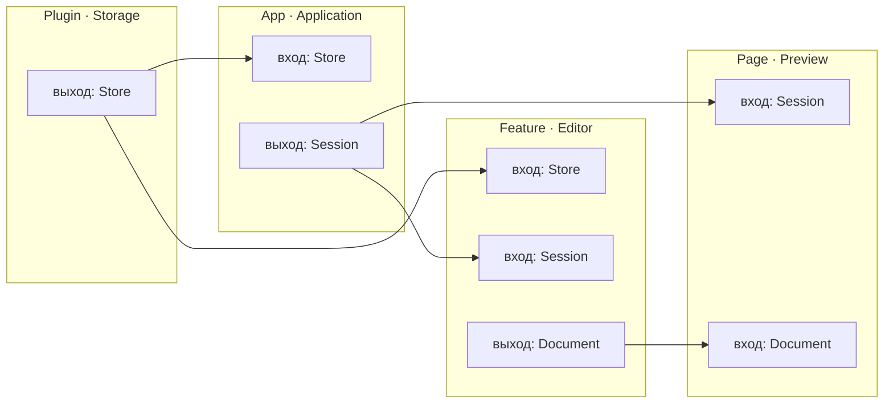
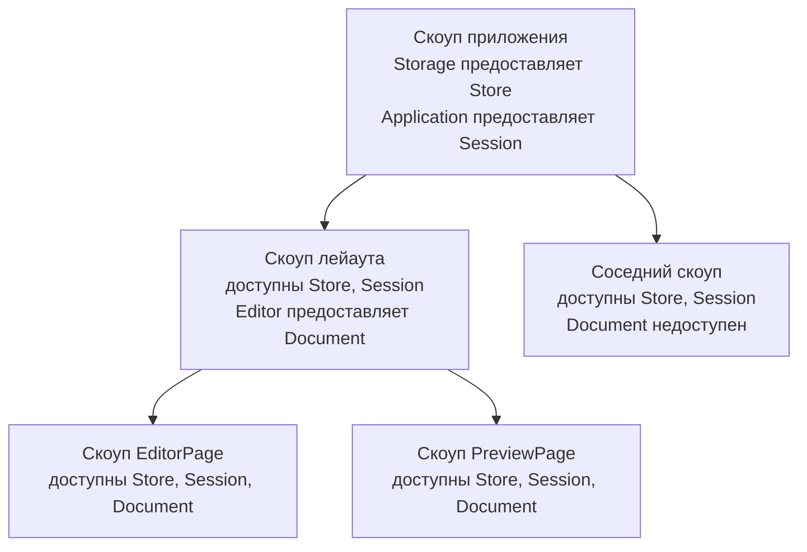

Каждая часть приложения объявляет свой контракт:

- **Входы** — аргументы установщика.
- **Выходы** — `provides` в декларации и значения, возвращённые установщиком.



`Storage` открывает хранилище. `Application` создаёт сессию. `Editor`
получает хранилище и сессию, открывает документ и предоставляет его
дочерним потребителям. Название у начала стрелки — выход, у конца — вход.

## Входы и выходы

`Store`, `Session`, `Document` и `StorageConfig` здесь — типы приложения.
Учебный пример использует хранилище в памяти; функции `open_store`,
`Session::new` и `Document::open` представляют код работы с этими ресурсами.
Импорты общего кода — `guinea::prelude::*`.

Плагин принимает явную конфигурацию и возвращает объявленный выход:

<!-- shown: dependencies: plugin outputs -->
```rust
plugin! {
    pub Storage {
        provides { Store }
    }
}

#[builds]
fn storage(_app: &mut PluginBuilder, config: StorageConfig) -> anyhow::Result<Storage> {
    Ok(Storage(open_store(config)?))
}
```
<!-- /shown -->

Первый аргумент после `PluginBuilder` — конфигурация этого экземпляра.
Последующие аргументы, если они есть, — зависимости. После успешной
установки guinea автоматически публикует значения из `provides`.

Фича уровня приложения принимает `Store` и предоставляет `Session`:

<!-- shown: dependencies: application inputs and outputs -->
```rust
feature! {
    pub Application {
        provides { Session }
    }
}

#[installs]
fn application(_app: &mut FeatureBuilder, store: Store) -> anyhow::Result<Application> {
    Ok(Application(Session::new(store)))
}
```
<!-- /shown -->

Обычная фича описывает контракт тем же способом:

<!-- shown: dependencies: feature inputs and outputs -->
```rust
feature! {
    pub Editor {
        provides { Document }
    }
}

#[installs]
fn editor(_cx: &Install, store: Store, session: Session) -> anyhow::Result<Editor> {
    Ok(Editor(Document::open(store, session)?))
}
```
<!-- /shown -->

Регистрировать выходы вручную или искать их в контексте не нужно.
Guinea передаёт потребителю клон значения: разделяет ли он один ресурс
или копирует данные, определяет сам тип.

## Порядок установки

Вход в декларации **не запускает установку провайдера**. Порядок задаёт
код сборки приложения:

<!-- shown: dependencies: application wiring -->
```rust
pub fn app(app: &mut FeatureBuilder) -> anyhow::Result<Store> {
    let Storage(store) = app.plugin::<Storage>(StorageConfig("Notes"))?;
    app.install::<Application>()?;
    Ok(store)
}
```
<!-- /shown -->

Возвращать `Store` из функции `app` необязательно: здесь это позволяет
тесту сохранить хендл без поиска в контексте. Публикация происходит
благодаря `Storage`, а не возвращаемому значению функции `app`.

## Страницы и лейауты

Они объявляют входы аргументами `install`. Эта часть одинакова для всех
бэкендов; отрисовка в следующих блоках опущена. `Page`, `Layout`, `page`
и `layout` импортируются из выбранного бэкенда.

Лейаут получает сессию и устанавливает фичу `Editor` в своём скоупе:

<!-- shown: dependencies: layout installation -->
```rust
struct WorkspaceLayout {
    session: Session,
    document: Document,
}

#[layout]
impl Layout for WorkspaceLayout {
    fn install(cx: &Install, session: Session) -> anyhow::Result<Self> {
        let Editor(document) = cx.install::<Editor>(&())?;
        Ok(Self { session, document })
    }
}
```
<!-- /shown -->

Страница, смонтированная этим лейаутом, получает сессию и документ:

<!-- shown: dependencies: page installation -->
```rust
struct EditorPage {
    session: Session,
    document: Document,
}

#[page]
impl Page for EditorPage {
    fn install(_cx: &Install, session: Session, document: Document) -> anyhow::Result<Self> {
        Ok(Self { session, document })
    }
}
```
<!-- /shown -->

`install` страницы или лейаута возвращает сам компонент, а не декларацию
выходов. Здесь `Document` предоставляет фича `Editor`, установленная
лейаутом. Лейаут монтирует `EditorPage` и `PreviewPage`; обе получают
`Session` и `Document`. Страница также может устанавливать свои фичи
через `cx.install`, но сама не монтирует дочерние страницы.

## Как значения проходят по дереву

Первая схема показывает связи деклараций. Доступность значений определяется
деревом скоупов:



Выход доступен в скоупе провайдера и ниже, но не в соседних ветках.
Новый выход дополняет окружение, а не заменяет унаследованные зависимости.
Удаление скоупа освобождает принадлежащие ему значения; сохранённые
снаружи копии хендлов живут по правилам самого типа.

## Ошибки подключения

Guinea собирает декларации через `inventory` и проверяет их **при запуске,
до установки приложения**. Она ищет отсутствующих и конфликтующих
провайдеров, противоречивые входы, повторные выходы и циклы.
Перед установкой дополнительно проверяется доступность входов в скоупе.

Это не вычисление графа при компиляции и не анализ тел функций.
Для generic-деклараций проверки, которым нужна конкретная специализация,
откладываются до её установки. Проверка не восстанавливает дерево
монтирования страниц или порядок вызовов из кода.

| Ситуация | Результат |
| --- | --- |
| Ресурс не удалось создать или открыть | `Err`, который можно передать через `?` |
| Зависимости подключены неверно | Паника с деревом ошибок |
| Вход `Option<T>`, провайдер не объявлен | `None` |
| Вход `Option<T>`, значение доступно | `Some(value)` |
| Вход `Option<T>`, провайдер объявлен, но значение недоступно | Паника |

`Option<T>` разрешает отсутствие зависимости в составе программы,
но не скрывает ошибку её подключения.

## Подмена в тестах

Используй одну декларацию провайдера с разной конфигурацией для production
и тестов: открыть настоящее подключение или принять подготовленный клиент.
Две конкретные декларации, предоставляющие один тип в одном исполняемом
файле, конфликтуют, даже если устанавливается только одна из них.
Альтернативные декларации можно исключать из сборки через `cfg`.

Хендлы для проверок получай из результата `app.plugin` или своей функции
`app`. В отличие от обычного запуска, `Harness` не запускает глобальную
проверку деклараций автоматически. Для теста состава приложения вызови
`guinea::app::validate_declarations()` отдельно.

Дальше: [установка плагинов](../plugins/) и
[страницы и лейауты](../pages/).
