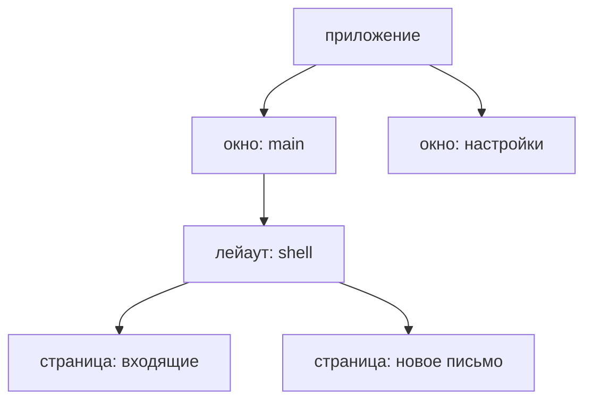

Всё, что создаёт фича — состояние, акторы, их таймеры и фоновые задачи,
подписки на шину, — живёт в **скоупе** и уничтожается вместе с ним. Скоупы
образуют дерево, которое повторяет устройство экрана:



Скоуп приложения живёт, пока работает процесс, скоуп окна — пока окно
открыто. Скоупы лейаутов и страниц живут, пока роутер держит их
смонтированными. Когда пользователь уходит со страницы, её скоуп удаляется
вместе со всеми вложенными, начиная с самых глубоких.

Сами скоупы приложение не создаёт: это делает роутер, когда пользователь
переходит между экранами. Приложение решает другое — **в какой скоуп ставить
каждую фичу**.

## Что стоит выше, видно ниже

Лейаут ставит фичу, которая нужна всем его страницам:

<!-- shown: scopes: a feature the layout installs -->
```rust
#[derive(Default, Clone, PartialEq, Debug)]
pub struct Unread(pub u32);

#[reducer]
fn unread(this: &mut Unread, arrived: u32) {
    this.0 += arrived;
}

pub struct Arrived;

#[derive(Debug)]
pub struct Mailbox {
    push: Push<Unread>,
}

actor! {
    Mailbox {
        handlers { Arrived }
    }
}

#[handler]
fn arrived(In(this, Arrived, _): In<Mailbox, Arrived>) {
    this.push.send(1);
}

feature! {
    pub Inbox {
        exports { Unread }
    }
}

#[installs]
fn inbox(cx: &Install) -> anyhow::Result<Inbox> {
    let (unread, _) = cx.state::<Unread>().driven_by(|push| Mailbox { push });
    Ok(Inbox(unread))
}
```
<!-- /shown -->

Благодаря `exports { Unread }` состояние `Unread` видно ниже по дереву.
Страница под лейаутом читает его и отправляет действия так, будто это её
собственное состояние, а обрабатывает их фича, которой оно принадлежит:

<!-- shown: scopes: a page reads what the layout exports -->
```rust
#[guinea::test]
fn a_page_reads_what_the_layout_above_exports(h: &mut Harness) {
    h.install::<Inbox>(&()).unwrap();
    let page = h.child();

    page.dispatch::<Unread>().emit(Arrived);
    h.settled();

    assert_eq!(page.state::<Unread>().0, 1);
    assert_eq!(h.state::<Unread>().0, 1);
}
```
<!-- /shown -->

В тестах вместо дерева — харнесс: `h` играет роль лейаута, а `h.child()` —
страницы под ним. Ни окна, ни роутера не нужно.

## Ушёл со страницы — всё остановилось

Страница ставит то, что нужно только ей. Эта раз в секунду сохраняет
черновик:

<!-- shown: scopes: a feature the page installs -->
```rust
#[installs]
fn composing(cx: &Install<Rc<Cell<u32>>>) -> anyhow::Result<Composing> {
    let draft = cx.state::<Draft>().plain();

    let saved = cx.params().clone();
    cx.repeat(Duration::from_secs(1), move || saved.set(saved.get() + 1));

    Ok(Composing(draft))
}
```
<!-- /shown -->

Код нигде не говорит, когда остановиться. Таймер принадлежит скоупу
страницы, а при уходе со страницы скоуп удаляется:

<!-- shown: scopes: leaving a page ends what it started -->
```rust
#[guinea::test]
fn leaving_a_page_ends_what_it_started(h: &mut Harness) {
    h.install::<Inbox>(&()).unwrap();
    let saved = Rc::new(Cell::new(0));

    let page = h.child();
    page.install::<Composing>(&saved).unwrap();
    h.advance(Duration::from_secs(3));
    assert_eq!(saved.get(), 3);

    page.leave();
    h.advance(Duration::from_secs(3));
    assert_eq!(saved.get(), 3);

    h.dispatch::<Unread>().emit(Arrived);
    h.settled();
    assert_eq!(h.state::<Unread>().0, 1);
}
```
<!-- /shown -->

Так же со всем остальным, что запустила страница: акторы уничтожаются, их
фоновые задачи отменяются, подписки снимаются. Лейаут над ней продолжает
работать как ни в чём не бывало. Код очистки писать не нужно — а значит, его
невозможно и забыть. Если есть ресурс, о котором guinea не знает, например
хендл из другой библиотеки, для него есть `cx.on_teardown`: замыкание
выполнится, когда скоуп удалят.

## Вверх ничего не видно

Видимость работает только сверху вниз. То, что заявила страница, не видно ни
лейауту над ней, ни соседней странице:

<!-- shown: scopes: what a page claims is not seen above it -->
```rust
#[guinea::test]
fn what_a_page_claims_is_not_seen_above_it(h: &mut Harness) {
    let page = h.child();
    page.install::<Composing>(&Rc::default()).unwrap();

    assert_eq!(page.scope().owner_of::<Draft>(), Some(page.scope()));
    assert_eq!(h.segment().scope().owner_of::<Draft>(), None);
}
```
<!-- /shown -->

Поэтому если одно состояние нужно двум страницам, фичу ставят в их общий
лейаут, а если двум окнам — в приложение. Правило простое: ставьте фичу в
самый нижний скоуп, который находится над всеми, кто её читает. Поставите
ниже — кто-то до неё не дотянется. Поставите выше — она переживёт экран, ради
которого была нужна.

Заодно это делает тесты маленькими. Странице доступно только своё, экспорты
лейаутов над ней и то, что предоставляет приложение, — значит, и тесту нужно
поднять только это.

## Для авторов плагинов и бэкендов

`Scope` — это имя скоупа, а не владелец: он `Copy`, а всё, что хранит скоуп,
на самом деле лежит в `ScopeTree`. Держать у себя `Scope` не значит продлевать
скоупу жизнь. Имя удалённого скоупа больше никогда не используется; жив ли
скоуп, можно проверить через `is_alive`.
