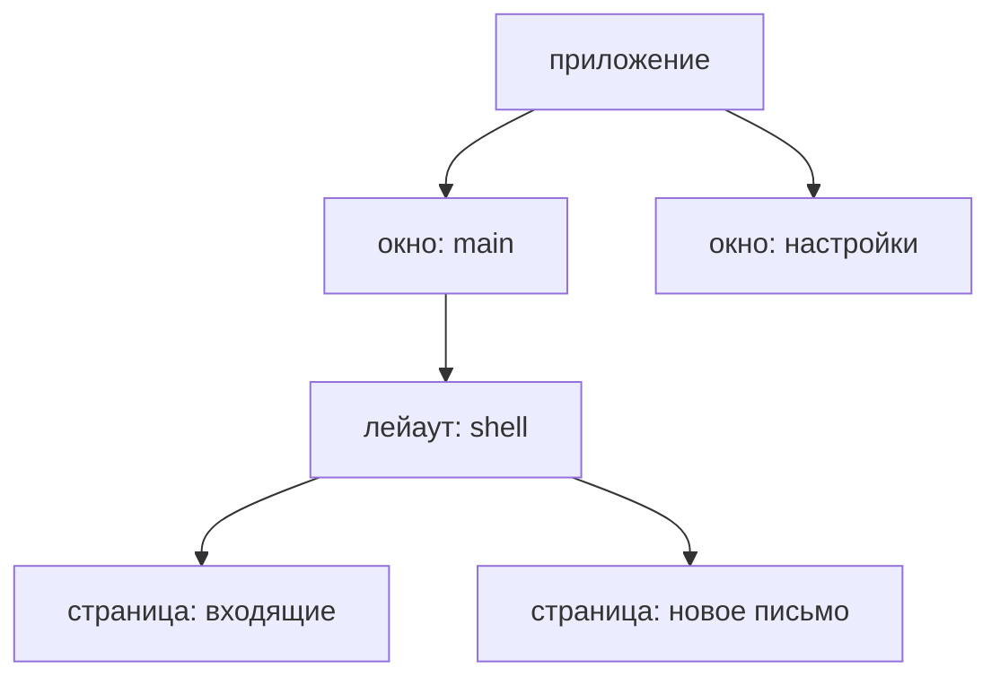

**Скоуп** определяет время жизни ресурсов. Установленные в нём фичи
регистрируют состояние, акторы, таймеры, фоновые задачи и подписки. Когда
скоуп удаляется, guinea освобождает эти ресурсы.

У приложения, окон, лейаутов и страниц свои скоупы. Они образуют дерево:



Скоуп приложения существует, пока живёт его `GuineaHost`. Бэкенд создаёт
под ним скоупы окон, а монтирование лейаутов и страниц добавляет следующие
уровни. Удаление родительского скоупа удаляет всё поддерево: сначала потомков,
затем сам родительский скоуп.

При обычном переходе со страницы её скоуп удаляется. Если страница
смонтирована с `keep`, её скоуп вместо удаления засыпает и сохраняется для
возвращения. В примерах ниже страницы не сохраняются через `keep`.

При работе со страницами не нужно создавать скоупы вручную: это делает
механизм монтирования. Место установки фичи выбираешь ты. От него зависят
время жизни её ресурсов и доступность состояния.

## Общее состояние в родительском скоупе

Если состояние нужно нескольким страницам, фичу можно установить в их общем
лейауте. Например, все страницы почты могут читать число непрочитанных писем:

<!-- shown: scopes: a feature the layout installs -->
```rust
#[derive(Default, Clone, PartialEq, Debug)]
pub struct Unread(pub u32);

#[reducer]
fn unread(this: &mut Unread, arrived: u32) {
    this.0 += arrived;
}

pub struct Arrived;

#[derive(Debug)]
pub struct Mailbox {
    push: Push<Unread>,
}

actor! {
    Mailbox {
        handlers { Arrived }
    }
}

#[handler]
fn arrived(In(this, Arrived, _): In<Mailbox, Arrived>) {
    this.push.send(1);
}

feature! {
    pub Inbox {
        exports { Unread }
    }
}

#[installs]
fn inbox(cx: &Install) -> anyhow::Result<Inbox> {
    let (unread, _) = cx.state::<Unread>().driven_by(|push| Mailbox { push });
    Ok(Inbox(unread))
}
```
<!-- /shown -->

Запись `exports { Unread }` делает `Unread` доступным для чтения в дочерних
скоупах. Страница читает состояние, принадлежащее лейауту, и получает
диспетчер его фичи. Поэтому действие `Arrived` обрабатывает тот же `Mailbox`:

<!-- shown: scopes: a page reads what the layout exports -->
```rust
#[guinea::test]
fn a_page_reads_what_the_layout_above_exports(h: &mut Harness) {
    h.install::<Inbox>(&()).unwrap();
    let page = h.child();

    page.dispatch::<Unread>().emit(Arrived);
    h.settled();

    assert_eq!(page.state::<Unread>().0, 1);
    assert_eq!(h.state::<Unread>().0, 1);
}
```
<!-- /shown -->

В этом тесте `h` представляет скоуп лейаута, а `h.child()` создаёт дочерний
скоуп страницы. Харнес позволяет проверить доступ к состоянию без окна
и роутера.

## Удаление скоупа останавливает работу

Фичу редактирования черновика установим на самой странице. В примере
автосохранение имитируется таймером: раз в секунду он увеличивает счётчик
`saved`. Записи в файл здесь нет — нас интересует время жизни таймера:

<!-- shown: scopes: a feature the page installs -->
```rust
#[installs]
fn composing(cx: &Install<Rc<Cell<u32>>>) -> anyhow::Result<Composing> {
    let draft = cx.state::<Draft>().plain();

    let saved = cx.params().clone();
    cx.repeat(Duration::from_secs(1), move || saved.set(saved.get() + 1));

    Ok(Composing(draft))
}
```
<!-- /shown -->

Функция установки запускает таймер, но не сохраняет ручку для его остановки.
Таймером владеет скоуп страницы. Проверим, что после удаления скоупа счётчик
больше не растёт:

<!-- shown: scopes: leaving a page ends what it started -->
```rust
#[guinea::test]
fn leaving_a_page_ends_what_it_started(h: &mut Harness) {
    h.install::<Inbox>(&()).unwrap();
    let saved = Rc::new(Cell::new(0));

    let page = h.child();
    page.install::<Composing>(&saved).unwrap();
    h.advance(Duration::from_secs(3));
    assert_eq!(saved.get(), 3);

    page.leave();
    h.advance(Duration::from_secs(3));
    assert_eq!(saved.get(), 3);

    h.dispatch::<Unread>().emit(Arrived);
    h.settled();
    assert_eq!(h.state::<Unread>().0, 1);
}
```
<!-- /shown -->

Удаление скоупа также завершает его акторы, отменяет их фоновые задачи и
снимает подписки. Родительский скоуп продолжает работать: в тесте фича
`Inbox` по-прежнему обрабатывает `Arrived`.

## Ресурс другой библиотеки на время жизни страницы

Допустим, страница создаёт миниатюры во временном каталоге. Пока страница
открыта, файлы нужны; при уходе их следует удалить. Крейт `tempfile`
предоставляет `TempDir`, который удаляет свой каталог вместе с содержимым
при `Drop`. guinea ничего не знает об этом объекте, пока ты не передашь
ей владение.

<!-- shown: scopes: a temporary cache belongs to the page -->
```rust
feature! {
    pub PreviewCache {}
}

#[installs]
fn preview_cache(cx: &Install<Path>) -> anyhow::Result<PreviewCache> {
    let cache = tempfile::Builder::new()
        .prefix("previews-")
        .tempdir_in(cx.params())?;
    cx.on_teardown(move || drop(cache));
    Ok(PreviewCache)
}
```
<!-- /shown -->

Через `cx.params()` передаётся родительский каталог, а установка создаёт
в нём отдельный кэш. Для этого примера нужен `tempfile` в зависимостях
приложения.

Если оставить `cache` локальной переменной, каталог удалится сразу при
возврате из функции установки. Вместо этого `move`-замыкание забирает
`TempDir` во владение, а `cx.on_teardown` сохраняет замыкание до удаления
скоупа. Вызов `drop(cache)` передаёт очистку библиотеке `tempfile`.

Тест записывает туда файл и проверяет, что уход со страницы удаляет кэш
с содержимым, но не родительский каталог:

<!-- shown: scopes: leaving deletes the temporary cache -->
```rust
#[guinea::test]
fn leaving_a_page_deletes_its_temporary_cache(h: &mut Harness) {
    let parent = tempfile::tempdir().unwrap();
    let page = h.child();
    page.install::<PreviewCache>(parent.path()).unwrap();

    let entries: Vec<_> = std::fs::read_dir(parent.path())
        .unwrap()
        .map(|entry| entry.unwrap().path())
        .collect();
    assert_eq!(entries.len(), 1);
    let cache = &entries[0];
    let thumbnail = cache.join("thumbnail.bin");
    std::fs::write(&thumbnail, b"preview").unwrap();
    assert!(thumbnail.exists());

    page.leave();

    assert!(!cache.exists());
    assert!(parent.path().exists());
}
```
<!-- /shown -->

Тест не сохраняет возвращённое значение фичи. Очисткой владеет скоуп,
поэтому кэш всё равно переживает функцию установки. По тому же принципу
можно передать в замыкание guard подписки другой библиотеки и удалить
его там. Если библиотека вместо этого требует явного вызова `unsubscribe`
или `close`, вызови его в обработчике очистки.

## Где искать состояние

Чтение начинается в скоупе самой страницы. Если нужного состояния там нет,
поиск идёт к предкам и находит ближайший скоуп, который его экспортирует.
В дочерние и соседние скоупы поиск не заходит. Поэтому состояние черновика
доступно на странице, но не в родительском лейауте:

<!-- shown: scopes: what a page claims is not seen above it -->
```rust
#[guinea::test]
fn what_a_page_claims_is_not_seen_above_it(h: &mut Harness) {
    let page = h.child();
    page.install::<Composing>(&Rc::default()).unwrap();

    assert_eq!(page.scope().owner_of::<Draft>(), Some(page.scope()));
    assert_eq!(h.segment().scope().owner_of::<Draft>(), None);
}
```
<!-- /shown -->

Для общего состояния выбери ближайшего общего предка всех его читателей:
лейаут для нескольких страниц или приложение для нескольких окон. Если
установить фичу ниже, часть страниц не найдёт её состояние. Если выше,
ресурсы фичи будут жить дольше, чем требуется.

Тесту страницы нужны те же зависимости: её собственные фичи, используемые
экспорты предков и данные приложения. Другие окна и соседние страницы
создавать не требуется.
