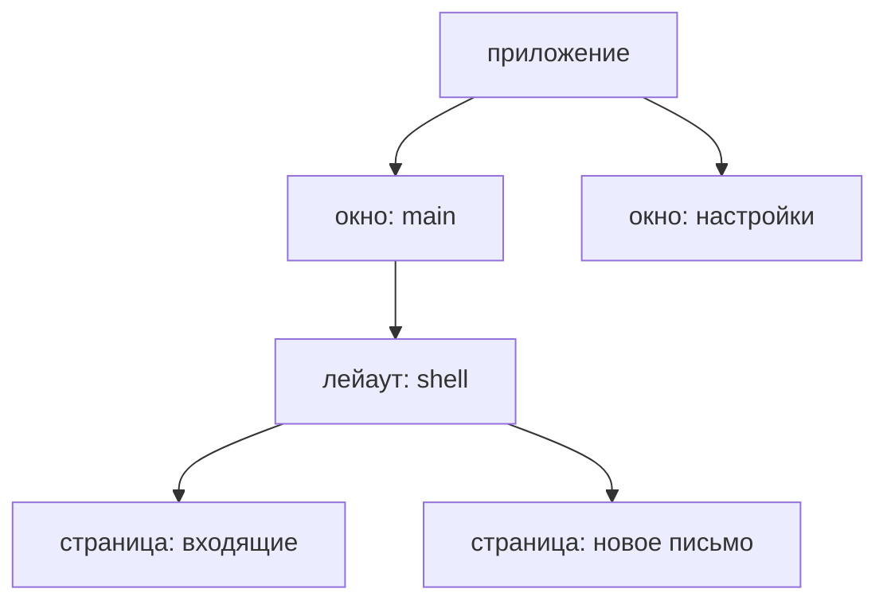

Всё, что заводит фича, - её состояние, акторы, их таймеры и фоновая работа,
то, что она слушает на шине, - живёт в **скоупе** и уходит вместе с ним.
Скоупы складываются в дерево, которое повторяет экран:



Скоуп приложения живёт столько же, сколько процесс. Скоуп окна - пока окно
открыто. Скоупы лейаута и страницы - пока роутер держит их смонтированными:
уход со страницы удаляет её скоуп и всё, что под ним, начиная с детей.

Приложение скоупы не создаёт. Их заводит роутер по мере того, как
пользователь ходит по экранам; приложение решает другое - **куда
устанавливается каждая фича**.

## Установлено выше - доступно ниже

Лейаут устанавливает фичу, которая нужна всем страницам под ним:

<!-- shown: scopes: a feature the layout installs -->
```rust
#[derive(Default, Clone, PartialEq, Debug)]
pub struct Unread(pub u32);

#[reducer]
fn unread(this: &mut Unread, arrived: u32) {
    this.0 += arrived;
}

pub struct Arrived;

#[derive(Debug)]
pub struct Mailbox {
    push: Push<Unread>,
}

actor! {
    Mailbox {
        handlers { Arrived }
    }
}

#[handler]
fn arrived(In(this, Arrived, _): In<Mailbox, Arrived>) {
    this.push.send(1);
}

feature! {
    pub Inbox {
        exports { Unread }
    }
}

#[installs]
fn inbox(cx: &FeatureInitContext) -> anyhow::Result<Inbox> {
    let (unread, _) = cx.state::<Unread>().driven_by(|push| Mailbox { push });
    Ok(Inbox(unread))
}
```
<!-- /shown -->

`exports { Unread }` - то, что делает `Unread` видимым ниже. Страница под
лейаутом читает его и действует так, будто оно её собственное, а действия
уходят фиче, которой оно принадлежит:

<!-- shown: scopes: a page reads what the layout exports -->
```rust
#[guinea::test]
fn a_page_reads_what_the_layout_above_exports(h: &mut Harness) {
    h.install::<Inbox>(&()).unwrap();
    let page = h.child();

    page.dispatch::<Unread>().emit(Arrived);
    h.settled();

    assert_eq!(page.state::<Unread>().0, 1);
    assert_eq!(h.state::<Unread>().0, 1);
}
```
<!-- /shown -->

В тесте дерево заменяет харнесс: `h` - это лейаут, а `h.child()` - страница
под ним, без окна и без роутера.

## Ушёл - кончилось

Страница устанавливает то, что нужно только ей. Эта сохраняет черновик раз в
секунду:

<!-- shown: scopes: a feature the page installs -->
```rust
#[installs]
fn composing(cx: &Install<Rc<Cell<u32>>>) -> anyhow::Result<Composing> {
    let draft = cx.state::<Draft>().plain();

    let saved = cx.params().clone();
    cx.repeat(Duration::from_secs(1), move || saved.set(saved.get() + 1));

    Ok(Composing(draft))
}
```
<!-- /shown -->

В ней нигде не сказано, когда остановиться. Таймер принадлежит скоупу
страницы, а уход со страницы этот скоуп удаляет:

<!-- shown: scopes: leaving a page ends what it started -->
```rust
#[guinea::test]
fn leaving_a_page_ends_what_it_started(h: &mut Harness) {
    h.install::<Inbox>(&()).unwrap();
    let saved = Rc::new(Cell::new(0));

    let page = h.child();
    page.install::<Composing>(&saved).unwrap();
    h.advance(Duration::from_secs(3));
    assert_eq!(saved.get(), 3);

    page.leave();
    h.advance(Duration::from_secs(3));
    assert_eq!(saved.get(), 3);

    h.dispatch::<Unread>().emit(Arrived);
    h.settled();
    assert_eq!(h.state::<Unread>().0, 1);
}
```
<!-- /shown -->

То же со всем остальным, что страница завела: её акторы утилизируются, их
фоновая работа отменяется, подписки снимаются. Лейаут выше продолжает
работать как ни в чём не бывало. Уборки, которую надо написать, нет - и
забыть её тоже нельзя. Для того, о чём guinea не знает, - хендла из другой
библиотеки - есть `cx.on_teardown`: замыкание выполнится, когда скоуп уйдёт.

## Вверх ничего не идёт

Чтение идёт только вниз. То, что заявила страница, не видит ни лейаут над
ней, ни страница рядом:

<!-- shown: scopes: what a page claims is not seen above it -->
```rust
#[guinea::test]
fn what_a_page_claims_is_not_seen_above_it(h: &mut Harness) {
    let page = h.child();
    page.install::<Composing>(&Rc::default()).unwrap();

    assert_eq!(page.scope().owner_of::<Draft>(), Some(page.scope()));
    assert_eq!(h.segment().scope().owner_of::<Draft>(), None);
}
```
<!-- /shown -->

Поэтому если одно состояние нужно двум страницам, оно ставится в их общий
лейаут, а если двум окнам - в приложение. Правило простое: ставь фичу в
самый нижний скоуп, который выше всех, кто её читает. Ниже - кто-то до неё не
дотянется; выше - она переживёт экран, ради которого заводилась.

Это же держит тесты маленькими. Странице доступно только то, что она
установила сама, что экспортируют лейауты над ней и что предоставляет
приложение, - и тест заводит ровно это и ничего больше.

## Для авторов плагинов и бэкендов

`Scope` - это имя, а не владелец: он `Copy`, а то, что держит каждый скоуп,
хранит `ScopeTree`. Держать `Scope` не значит держать скоуп живым, а имя
удалённого скоупа никогда не возвращается - жив ли он ещё, говорит
`is_alive`.
