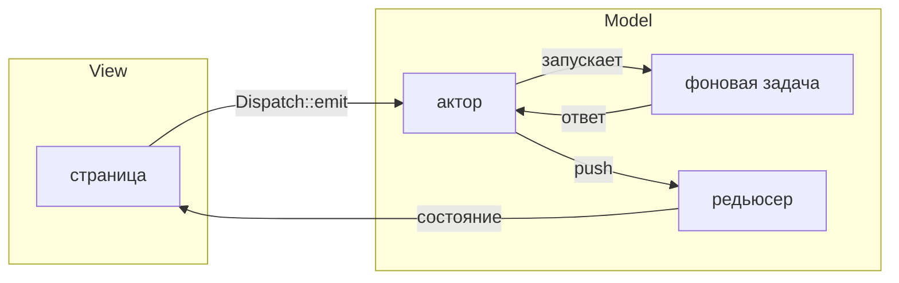

GUI-тулкит даёт приложению окна, элементы интерфейса и обработку ввода.
Но приложению нужно и другое: хранить состояние, выполнять фоновые задачи,
переключать экраны и сохранять настройки. Как связать всё это с интерфейсом,
каждый проект решает по-своему.

По мере роста приложения возникают одни и те же вопросы:

- Как доставить действие пользователя нужному обработчику без цепочки
  промежуточных сообщений?
- Как не дать ответу на старый запрос перезаписать результат нового?
- Кто остановит задачи и подписки экрана, когда пользователь его закроет?
- Где хранить состояние, общее для нескольких экранов?
- Как проверить логику приложения без запуска интерфейса?
- Как сохранять настройки и сообщать об их изменениях?

guinea предлагает общую структуру для такого приложения. Она связывает
интерфейс с логикой и управляет временем жизни ресурсов. Сам интерфейс
остаётся на выбранном тулките: WinUI, iced, egui, ratatui или Slint.

## Что такое guinea

В основе guinea — MVI: действия пользователя, состояние приложения и
представление разделены, а изменения проходят по определённому пути.

- **Intent** — действие, которое страница отправляет от имени пользователя:
  добавить задачу, обновить список, сохранить документ.
- **Model** — состояние и логика его изменения. Актор обрабатывает действия,
  а редьюсер применяет подготовленные им обновления к состоянию.
- **View** — страница, которая читает состояние и строит интерфейс средствами
  своего тулкита.

Если действие требует фоновой работы, обработка выглядит так:



1. Страница отправляет действие через `Dispatch::emit`.
2. Актор обрабатывает его и запускает фоновую задачу — например, запрос к
   серверу или чтение файла. Результат приходит актору сообщением.
3. Актор отправляет обновление, а редьюсер меняет состояние.
4. Страница читает результат и обновляет интерфейс.

Для простого действия фоновая задача не нужна: актор может сразу отправить
обновление. А данные, которые нужны только самой странице, она хранит в
собственной структуре. Например, текст фильтра или выбранную вкладку не нужно
проводить через актор и редьюсер.

## Состояние и время жизни

Логика приложения собрана в **фичи**. Фича устанавливает своё состояние,
обработчики, подписки и фоновые задачи в **скоуп** — область с определённым
временем жизни. У приложения, окна, лейаута и страницы свои скоупы.

Когда скоуп страницы удаляется, вместе с ним освобождаются её ресурсы:
фоновые задачи отменяются, таймеры останавливаются, подписки снимаются.
Для ресурсов guinea отдельный код очистки не нужен.

Место установки фичи определяет, кто видит её состояние и как долго оно
живёт. Если список нужен одной странице, фичу можно установить на ней. Если
нескольким — в их общем лейауте. Если разным окнам — на уровне приложения.

Страница читает состояние своих фич, экспорты родительских лейаутов и данные,
которые предоставляет приложение. Эти же зависимости задаются в тесте:
можно установить нужную фичу, отправить действие и проверить результат без
остального приложения.

## Два слоя

Книга разделена на две части:

- **Слой приложения** — [скоупы](../concepts/scopes/),
  [фичи и состояние](../concepts/features/), плагины, акторы, обмен данными
  и фоновая работа. Эти правила не зависят от GUI-библиотеки.
- **Интеграция с бэкендами** — [страницы и лейауты](../concepts/pages/)
  и [композиция интерфейса](../concepts/composition/): подключение логики
  к окнам, чтение состояния из UI, маршрутизация, монтирование
  и перерисовка. Примеры переключаются между бэкендами; различия описаны
  явно, без предположения об одинаковом API всех адаптеров.

Начни со слоя приложения, чтобы определить поведение и проверить его
без окна. К интеграции переходи при подключении этой логики к GUI-библиотеке.
В примере слоя приложения страница может упоминаться как владелец ресурсов;
код монтирования и отрисовки конкретного бэкенда относится ко второй части.

## Первый взгляд

Ниже — фича счётчика. `Count` хранит значение, редьюсер прибавляет к нему
полученное число, а актор `Counting` обрабатывает действие `Add`. Функция
`counter` создаёт состояние и актор при установке фичи.

<!-- shown: introduction: a feature -->
```rust
#[derive(Default, Clone, PartialEq, Debug)]
pub struct Count(pub u32);

#[reducer]
fn count(this: &mut Count, by: u32) {
    this.0 += by;
}

pub struct Add(pub u32);

#[derive(Debug)]
pub struct Counting {
    push: Push<Count>,
}

actor! {
    Counting {
        handlers { Add }
    }
}

#[handler]
fn add(In(this, Add(by), _): In<Counting, Add>) {
    this.push.send(by);
}

feature! {
    pub Counter {
        exports { Count }
    }
}

#[installs]
fn counter(cx: &Install) -> anyhow::Result<Counter> {
    let (count, _) = cx.state::<Count>().driven_by(|push| Counting { push });
    Ok(Counter(count))
}
```
<!-- /shown -->

Тест устанавливает счётчик и отправляет два действия `Add`, как это сделала
бы страница. После обработки действий он проверяет значение `Count`.
Окно и цикл событий GUI для этого не нужны.

<!-- shown: introduction: a test -->
```rust
#[guinea::test]
fn what_is_added_is_counted(h: &mut Harness) {
    h.install::<Counter>(&()).unwrap();

    h.dispatch::<Count>().emit(Add(2));
    h.dispatch::<Count>().emit(Add(3));
    h.settled();

    assert_eq!(h.state::<Count>().0, 5);
}
```
<!-- /shown -->
