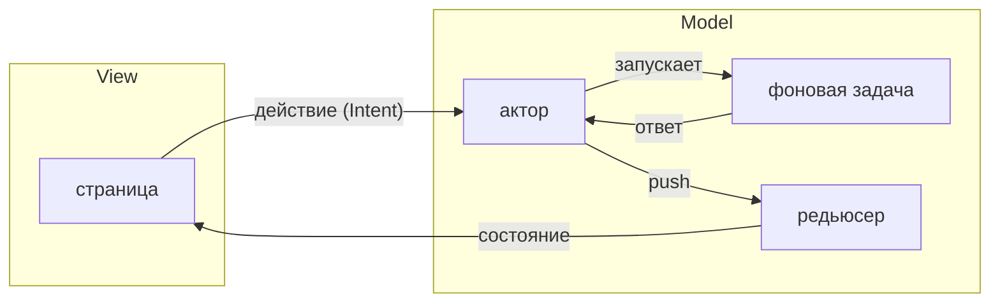

В Rust есть хорошие тулкиты, но нет прикладного слоя над ними: тулкит рисует
экран, а как устроить приложение вокруг него, каждый решает сам. Решения
выходят разными, но задачи в любом приложении сложнее демки одни и те же:

- сообщения, которые пробрасываются через все слои до того, кто их обработает;
- id запросов, чтобы поздний ответ не затёр свежий;
- инициализация, очистка и повторная загрузка данных, написанные руками на
  каждом экране;
- одно огромное состояние, в которое лезут все и которое никто не тестирует;
- настройки, которые сохраняют и синхронизируют вручную.

## Что такое guinea

MVI для всего приложения:

- **Intent** — страница сообщает, что попросил пользователь, а сама меняет
  только своё состояние отображения;
- **Model** — редьюсер, единственное место, где меняется состояние, и актор,
  который решает, что в него записать;
- **View** — страница, написанная так, как принято в её тулките: WinUI, iced,
  egui, ratatui или Slint.

Клик проходит один и тот же круг:



1. Страница отправляет действие — что попросил пользователь, а не что
   поменять.
2. Актор фичи, которой принадлежит состояние, решает, что это действие
   значит. Долгая работа — запрос, чтение файла — идёт фоновой задачей, и её
   ответ возвращается актору ещё одним сообщением.
3. Актор записывает изменение в редьюсер — единственное место, где меняется
   состояние.
4. Страница читает новое состояние и перерисовывается.

То, что важно только самой странице, — какая вкладка открыта, что набрано в
фильтре, — по этому кругу не ходит: страница хранит это у себя.

Приложение собирается из страниц. Всё живёт в скоупах — приложения, окна,
лейаута, страницы — и уничтожается вместе с ними. Пользователь ушёл со
страницы — и всё, что она запустила, остановилось само. Ничего не нужно
чистить руками.

Состояние лежит рядом с экраном, которому оно нужно. Если его надо разделить
между экранами, фичу ставят выше — в лейаут или в приложение. Страница видит
только своё, экспорты лейаутов над ней и то, что предоставляет приложение. До
остального она не дотянется, поэтому и тесту нужно поднять только это.

## Первый взгляд

Счётчик целиком: состояние, редьюсер (единственное место, где оно меняется),
актор, который решает, что туда записать, и фича, которая их связывает.

<!-- shown: introduction: a feature -->
```rust
#[derive(Default, Clone, PartialEq, Debug)]
pub struct Count(pub u32);

#[reducer]
fn count(this: &mut Count, by: u32) {
    this.0 += by;
}

pub struct Add(pub u32);

#[derive(Debug)]
pub struct Counting {
    push: Push<Count>,
}

actor! {
    Counting {
        handlers { Add }
    }
}

#[handler]
fn add(In(this, Add(by), _): In<Counting, Add>) {
    this.push.send(by);
}

feature! {
    pub Counter {
        exports { Count }
    }
}

#[installs]
fn counter(cx: &Install) -> anyhow::Result<Counter> {
    let (count, _) = cx.state::<Count>().driven_by(|push| Counting { push });
    Ok(Counter(count))
}
```
<!-- /shown -->

Тест ставит фичу без всего остального, отправляет то, что прислала бы
страница, и проверяет результат. Без окна и без цикла событий.

<!-- shown: introduction: a test -->
```rust
#[guinea::test]
fn what_is_added_is_counted(h: &mut Harness) {
    h.install::<Counter>(&()).unwrap();

    h.dispatch::<Count>().emit(Add(2));
    h.dispatch::<Count>().emit(Add(3));
    h.settled();

    assert_eq!(h.state::<Count>().0, 5);
}
```
<!-- /shown -->
