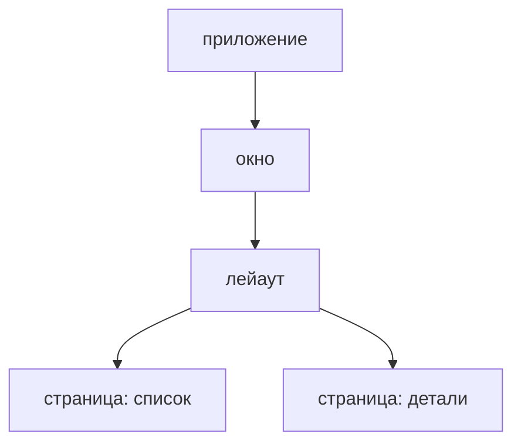

В Rust есть хорошие тулкиты и нет прикладного слоя над ними. Архитектура
остаётся на вас, её заимствуют из языков со сборщиком мусора, и владение в Rust
с ней воюет. Остаётся проводка - в каждом тулките своя, но ни одно приложение
сложнее демо без неё не обходится:

- сообщения, которые пробрасывают через слои туда, где их обрабатывают;
- id запросов, чтобы опоздавший ответ не затёр более новый;
- установка, уборка и перезапрос данных руками на каждом экране;
- одно огромное состояние, в которое лезут все, и никаких тестов на него;
- хендлы, протащенные через конструкторы, и `clone()` перед каждым `move`;
- настройки, которые сохраняют и синхронизируют руками.

## Что такое guinea

MVI для всего приложения:

- **Intent** - страница сообщает, чего попросил пользователь, и меняет только
  своё состояние отображения;
- **Model** - редьюсер, единственное место, где меняется состояние, и актор,
  который решает, что в него отправить;
- **View** - страница, написанная так, как принято в её тулките: WinUI, iced,
  egui, ratatui или Slint.

Приложение собирается из страниц. Всё живёт в скоупе - приложения, окна,
лейаута, страницы - и уходит вместе с ним: то, что страница завела, кончается,
когда пользователь с неё уходит, и убирать ничего руками не нужно.



Состояние живёт рядом с экраном, которому оно нужно, а общим становится, если
установить его выше - в лейауте или в приложении. Страница читает то, что
установила сама, то, что экспортирует лейаут над ней, и то, что предоставляет
приложение; остальное ей недоступно, и тест заводит ровно это и не больше.

## Первый взгляд

Счётчик: состояние, редьюсер - единственное место, где оно меняется, актор,
который решает, что в него отправить, и фича, которая устанавливает их вместе.

<!-- shown: introduction: a feature -->
```rust
#[derive(Default, Clone, PartialEq, Debug)]
pub struct Count(pub u32);

#[reducer]
fn count(this: &mut Count, by: u32) {
    this.0 += by;
}

pub struct Add(pub u32);

#[derive(Debug)]
pub struct Counting {
    push: Push<Count>,
}

actor! {
    Counting {
        handlers { Add }
    }
}

#[handler]
fn add(In(this, Add(by), _): In<Counting, Add>) {
    this.push.send(by);
}

feature! {
    pub Counter {
        exports { Count }
    }
}

#[installs]
fn counter(cx: &Install) -> anyhow::Result<Counter> {
    let (count, _) = cx.state::<Count>().driven_by(|push| Counting { push });
    Ok(Counter(count))
}
```
<!-- /shown -->

Тест устанавливает фичу без всего остального, отправляет то, что отправила бы
страница, и читает результат. Ни окна, ни цикла событий.

<!-- shown: introduction: a test -->
```rust
#[guinea::test]
fn what_is_added_is_counted(h: &mut Harness) {
    h.install::<Counter>(&()).unwrap();

    h.dispatch::<Count>().emit(Add(2));
    h.dispatch::<Count>().emit(Add(3));
    h.settled();

    assert_eq!(h.state::<Count>().0, 5);
}
```
<!-- /shown -->
